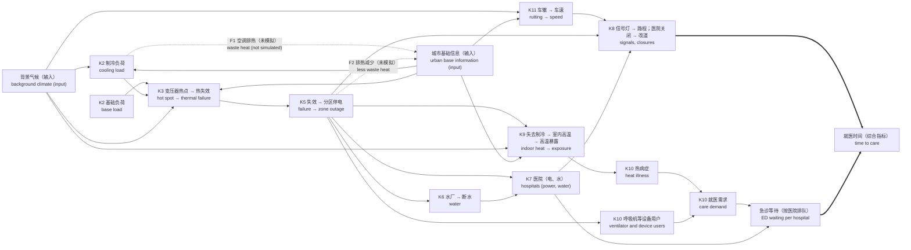

# 精简主线模型（骨架）Core skeleton model

2026-11-03 · 代码 Code：[`pipeline/twin/core.py`](../pipeline/twin/core.py)、[`pipeline/core.py`](../pipeline/core.py) · 组成清单 Manifest：[`twin/core.yaml`](../twin/core.yaml)

## 0. 结构调整 Structure revisions

### 0.1 2026-11-20

**中文：**（同一天先做了电力部分的简化测试，随后用户调整了结构，下面是最终结构。）
- **气候层只作输入。** 背景气候和城市基础信息之间不再画关系线（原 R01 取消），下游每条关系都直接从其中一个或两个出发；模型的计算不变（本地气温 = 背景序列 + 城市距平）。
- **用电负荷拆成基础负荷和制冷负荷，保留在模型中（K2）。** 基础负荷不随气温，占设计日负荷的 1/m(Td)（约 0.57–0.75）；制冷负荷在 T0 以上按斜率 β 线性上升。两者之和驱动 IEEE C57.91 热点温度（K3）。计算与原 K2–K3 相同，只是把两部分分开表达。同日测试过的两参数气温脆弱性曲线（M-48，§4.7）在 2,000 次运行中与负荷链结果相差 3–8%，保留为 `--power fragility` 选项。
- **去掉供电依赖（暂缓 D13）。** 变电站热失效只使它自己供电的分区停电，不再沿 OSM 拓扑传到下游站。原因：拓扑来自开关状态未知的 OSM 线路，35% 是占位边；2026-11-17 的敲除实验中，这种传播约占就医时间均值的一半，所以结果会明显变小。`--supply-dependency` 可恢复。
- **系统缺口仍暂缓（D12）。** `--shortfall` 可恢复。
- **车辙进入 A 线（K11，M-49）。** 情景升温使 HPMS 实测车辙加深（每 °C 约 1.8%，本地横截面），路面平整度变差（每英寸车辙 IRI 约 +395 英寸/英里，本地拟合），车速下降（每英寸/英里 IRI 约 0.0056 mph，Wang 等 2014）；到最近医院的路程变化加到就医时间，原因分解中单列 rutting。
- **标出会反过来影响温度的循环（只标注，未模拟）。** F1：制冷负荷 → 空调排热 → 城市气温升高 → 制冷负荷更大（Salamanca 等 2014）；F2：停电 → 空调停止 → 排热减少（与 F1 方向相反）；F3：火电厂温排水 → 河水变暖（与暂缓的 D2 相连）。
- **关系图集中暂缓项可以整页隐藏。**

**English:** (A power simplification was tested earlier the same day; the user then revised the structure. This is the final structure.)
- **The climate layer is input only.** No relation line joins background climate and urban base information (former R01 removed); every downstream relation starts from one or both. The computation is unchanged (local temperature = background series + urban anomaly).
- **Load is split into base and cooling load and stays in the model (K2).** Base load does not depend on temperature and is 1/m(Td) of the design-day load (about 0.57–0.75); cooling load rises with slope β above T0. Their sum drives the IEEE C57.91 hot spot (K3). The arithmetic is that of the former K2–K3, written as two parts. The two-parameter air-temperature fragility tested the same day (M-48, §4.7) matched the load chain within 3–8% over 2,000 runs and remains available as `--power fragility`.
- **Supply dependency is removed (deferred D13).** A thermally failed substation now cuts only the zone it serves, with no propagation down the OSM topology, whose switch states are unknown and 35% of whose edges are placeholders. In the 2026-11-17 knockouts this propagation carried about half of the mean time to care, so results become markedly smaller. `--supply-dependency` restores it.
- **The system shortfall stays deferred (D12);** `--shortfall` restores it.
- **Rutting enters line A (K11, M-49).** Warming deepens the HPMS-measured ruts (about 1.8% per °C, local cross-section), roughness rises (about +395 in/mi of IRI per inch of rut, local fit) and free-flow speed falls (about 0.0056 mph per in/mi of IRI; Wang et al. 2014); the change in travel to the nearest hospital is added to time to care and shown as "rutting" in the decomposition.
- **Feedback loops that act back on temperature are marked, not simulated.** F1: cooling load → air-conditioning waste heat → warmer urban air → more cooling load (Salamanca et al. 2014); F2: outage → air conditioners stop → less waste heat (opposite to F1); F3: heated discharge from thermal plants → warmer river (tied to deferred D2).
- **Deferred items can be hidden across the whole relation atlas.**

### 0.2 2026-11-17

**中文：**
- **医疗设施只保留医院。** 透析中心和养老院从骨架中移出（暂缓 D10，代码留在完整模型）。医院同时依赖电和水：分区停电且备用电源失效，或全系统断水超过院内储水时长（C-H18，T4 占位）时关闭；关闭的小时数按比例减少急诊接诊能力，病人改去下一家开放的医院。
- **B 线分成"热病症"和"就医需求"两个节点。** 就医需求有两个来源：热病症（高温暴露 → 热病症 → 就医需求）和停电后的呼吸机等家用医疗设备用户（分区停电 → 设备用户 → 就医需求）。
- **就医时间按原因分解。** 每次运行的增量用 Shapley 方法分给热病症新增就诊、设备用户新增就诊、医院停电、医院断水四项，拥堵另列（`pipeline/care.py`）；`python -m pipeline.extremes` 按就医时间分档汇总，并做通径分析（§4.6）。
- **流程。** `python -m pipeline.run_all` 一条命令按顺序跑完测试、骨架、极端分析、敲除、情景、热浪、报告、登记检查和关系图集。

**English:**
- **Medical facilities are hospitals only.** Dialysis centres and nursing homes leave the core (deferred D10; code stays in the full model). Hospitals depend on power and water: a hospital closes when its zone is out and backup fails, or when system water loss outlasts its on-site supply (C-H18, T4 placeholder); closed hours reduce ED capacity in proportion and send patients to the next open hospital.
- **Line B splits heat illness from care demand.** Care demand has two sources: heat illness (exposure → heat illness → demand) and users of ventilators and other home devices who lose power (zone outage → device users → demand).
- **Time to care is decomposed by cause.** Each run's increase is split by Shapley decomposition over heat-illness visits, device-user visits, hospital power and hospital water, with congestion separate (`pipeline/care.py`); `python -m pipeline.extremes` summarises it by severity and runs a path analysis (§4.6).
- **Workflow.** `python -m pipeline.run_all` runs tests, core, extremes, knockouts, variants, heat waves, report, registry and atlas in order.

### 0.3 2026-11-10

**中文：**
- **气候层只保留两个节点。** 背景气候（气温、地表温度、河温）和城市基础信息（城市热分布，目前是 2022 年走航测温的气温场）。之后会拿到一份完整的历史数据包；在那之前，模拟继续用现有记录（BNA 2014–2025、2023 年地表温度、模拟河温）。
- **暂不考虑经济损失。** D9 经济损失和 D3 车辙成本标为暂停，代码、变量和证据保留。
- **结局层围绕两条线组织，都以就医时间为综合指标。** 医院、养老院、透析中心合并为"医疗设施"一层，各自保留备用规则（2026-11-17 起只保留医院，见 0.2）。A 线：电、水、交通影响医疗设施和路程，使就医时间增加（K6–K8，已模拟）。B 线：高温使热相关病症和就医人数增加，需求超过设施容量时产生等待，同样拉长就医时间（K10，2026-11-11 起第一版已模拟）。就医时间 = 路程时间 + 等待时间。

**English:**
- **The climate layer keeps two nodes:** background climate (air temperature, land surface temperature, river temperature) and urban base information (the city's heat pattern, now the 2022 traverse field). A complete historical package will replace the current records (BNA 2014–2025, 2023 LST, modelled river temperature); until then the model runs on them.
- **Economic loss is paused.** D9 economic loss and D3 rutting cost are marked paused; code, variables and evidence are kept.
- **The outcome layer is organised around two lines that both end in time to care.** Hospitals, nursing homes and dialysis centres form one medical-facility layer with their own backup rules (hospitals only since 2026-11-17, see 0.2). Line A: power, water and transport disrupt facilities and the trip, raising time to care (K6–K8, simulated). Line B: heat raises heat-related illness and the number of people seeking care; demand beyond capacity adds waiting (K10, simulated as v1 since 2026-11-11). Time to care = travel time + waiting time.

## 1. 目的与副本 Purpose and the preserved full model

**中文：** 完整模型（v0 + 2026-10-30 的四个模块）把很多关系都接了进来，但其中不少环节的参数是占位值，而且彼此叠加，结果很难解释。骨架模型只保留文献证据最强、从气温到人群受害不可缺少的一条主线，其余环节暂缓，代码不删。完整模型原样保留在 git 分支 `full-model`、标签 `full-model-v1`（提交 `04eb531`）；在 main 上它仍可用 `python -m pipeline.cascade` 运行。

**English:** The full model (v0 plus the four modules of 2026-10-30) wires in many relations, several with placeholder parameters that compound and make results hard to interpret. The core keeps only the chain that the literature supports most strongly and that cannot be cut without breaking the path from air temperature to harm. Everything else is deferred with its code kept. The full model is preserved unchanged on git branch `full-model`, tag `full-model-v1` (commit `04eb531`), and still runs on main as `python -m pipeline.cascade`.

## 2. 选取原则 Selection rule

**中文：** 一个环节进入骨架，需要同时满足：
1. 文献把它记录为"热浪期间高温 → 停电 → 人群受害"链条上的一环；
2. 去掉它，从气温到结局的链条就断了；
3. 用现有数据就能运行。

属于二阶效应、所用机制被文献质疑、或在我们自己的数据中没有作用的环节暂缓。

**English:** A link enters the core only if all three hold:
1. The literature documents it as part of the heat → outage → harm pathway during heat waves.
2. Removing it would cut the chain from air temperature to the outcome.
3. It runs on data we already hold.

Second-order effects, mechanisms the literature warns against, and links that showed no effect in our own data are deferred.

## 3. 骨架 Skeleton



| 环节 Link | 内容 Content | 方法 / 公式 Method | 参数 Parameters | 文献依据 Evidence |
| --- | --- | --- | --- | --- |
| K1 | 城市气温场 θ_A(x,t)（背景气候与城市基础信息只作输入）/ urban air-temperature field (inputs only) | M-6 | — | shandas2019, ho2014 |
| K2 | 本地气温 → 制冷负荷；基础负荷不随气温 / local temperature → cooling load; base load | Eq. 2–3 | C-P1, C-P1.T0, C-P1.Kd, C-P1.Td | auffhammer2017, bartos2016, salamanca2014 |
| K3 | 基础 + 制冷负荷与气温 → 热点温度 → 热失效 / base + cooling load and air temperature → hot spot → failure | Eq. 4–7 | C-P2.*, C-P3, C-P3.sigma | ieee_c5791_2011, bartos2016, shinozuka2000 |
| K5 | 失效的变电站 → 它供电的分区停电；固定修复（2026-11-20 起不沿拓扑传播，D13）/ failed station → its zone out; fixed repair (no propagation since 2026-11-20) | Eq. 10, 14 | C-P6, C-POP1 | eaglei2023, stone2023 |
| K6 | 水厂失电 → 储水耗尽 / plant power loss → storage exhausted | Eq. 13 | C-W1, C-W2, C-W3 | rinaldi2001, klise2017 |
| K7 | 医院：停电且备用失效，或断水超过院内储水 / hospitals: power with backup, water beyond on-site supply | Eq. 11 | C-H1, C-H18 | cms2016, marqusee2020, irvinbarnwell2020 |
| K8 | 信号灯熄灭 → 通行能力 → 到医院的行程时间；医院关闭 → 改道 / dark signals → capacity → travel time; closures → rerouting | Eq. 11, 16, M-28, M-29 | C-T2, C-T3, C-T5, C-T6.* | rinaldi2001, ouyang2014, hcm2022, bpr1964 |
| K9 | 失去空调 → 室内温度 → 暴露 / loss of AC → indoor heat exposure | M-32, M-33 | C-B1–C-B4, C-H10 | stone2023, sun2020 |
| K10 | B 线：高温暴露 → 热病症 → 就医需求；分区停电 → 呼吸机等设备用户 → 就医需求；需求 → 急诊等待 / line B: heat illness and device users → care demand → ED waiting | M-47 | C-H11–C-H16 | tdh_hri_ed, hhs_empower, lin2011 |
| K11 | 路面高温 → 车辙 → 平整度 → 车速 → 到医院的路程（2026-11-20）/ pavement heat → rutting → roughness → speed → travel to hospitals | M-49 | C-T8, C-T11, C-T12 | fhwa_hpms2024, wang2014roughness |

**中文：** K8 是交通系统保留的主线：它是交通环节中唯一直接连到健康结局的一条（停电 → 信号灯 → 到医院的时间），而且医院关闭后病人必须转去别处。与完整模型不同，K8 按每次运行在其最坏小时的实际状态计算，保留尾部情形。

**English:** K8 is the transport link kept in the core: it is the one transport pathway that reaches a health outcome (outage → signals → time to care), and patients of a closed hospital must travel elsewhere. Unlike the full model, K8 is computed per run at that run's worst hour, so tail cases are kept.

**中文：** K9 是这次新加的一环，也是骨架的结局。Stone 等（2023）发现热浪期间的多日停电使高温死亡率增加一倍以上，机制就是失去制冷后的室内温度，所以骨架停在"室内高温暴露人·小时"上，而不是用室外气温阈值（完整模型的 C-POP2）。

**English:** K9 is new and is the core's endpoint. Stone et al. (2023) found that a multiday blackout during a heat wave more than doubles heat-related mortality, through indoor temperature once cooling is lost. The core therefore ends at indoor heat person-hours rather than an outdoor threshold (C-POP2 in the full model).

## 4. 公式 Equations

**中文：** K2–K8 与完整模型的 Eq. 2–16 相同（见 [`HANDBOOK.md`](HANDBOOK.md) §4），差别是：标幺负荷不加邻站转来的负荷；2026-11-20 起没有供电依赖（每座站只由自身失效或被切除决定，分区跟随它的供电站），也不计算系统缺口。负荷写成基础负荷与制冷负荷之和：

**English:** K2–K8 follow Eq. 2–16 of the full model ([`HANDBOOK.md`](HANDBOOK.md) §4), except that per-unit load includes no transferred load and, since 2026-11-20, there is no supply dependency (each station is out only if it failed or was shed; a zone follows its serving station) and no system shortfall. Load is written as base plus cooling load:

```math
K_s(t)=K_d\,\frac{\overbrace{1}^{\text{base}}+\overbrace{\beta\max(0,T_s(t)-T_0)}^{\text{cooling}}}{1+\beta\max(0,T_d-T_0)},\qquad
e_s(t)=\neg f_s(t)\wedge\neg\mathrm{shed}_s(t),\qquad d_z(t)=\neg e_{s(z)}(t)
```

**K11（M-49）：** 情景升温 $`\Delta T`$ 下每条有实测车辙的路段车速降低 $`\Delta v_e = c\,b\,k\,\Delta T\,r_e`$；每次急诊就诊的路程增量 $`U\,k\,\Delta T\,b\,c`$，其中 $`U`$ 为"每英寸车辙降 1 mph"时到最近医院的人口加权路程增量（`care.rut_unit`）。 **K11 (M-49):** with warming $`\Delta T`$, each edge with a measured rut slows by $`\Delta v_e = c\,b\,k\,\Delta T\,r_e`$; the added travel per ED visit is $`U\,k\,\Delta T\,b\,c`$, with $`U`$ the population-weighted change in travel to the nearest hospital for 1 mph per inch of rut (`care.rut_unit`).

**K8（M-28、M-29）：** 每次运行 $`r`$ 取其降级路段最多的小时 $`h_r`$。受控路段的通行能力乘以该次运行抽到的 $`\varphi_{dark}`$（C-T5），关闭的医院不再作为目的地；行程时间增量相对同一小时的正常情况计算（BPR 路段延误，TMAS 工作日小时曲线；路段容量参数取中值）。

**K8 (M-28, M-29):** For each run $`r`$, take its hour $`h_r`$ with the most degraded segments. Capacities of controlled segments are multiplied by that run's $`\varphi_{dark}`$ (C-T5) and closed hospitals are removed as destinations. The increase is taken against the normal time at the same hour (BPR link delay, TMAS weekday profile, mid lane capacities).

```math
\Delta\tau_{c,k}(r)=\min_{f\in F_k\setminus D_r}SP_{\varphi_r}\big(c,f;h_r\big)-\min_{f\in F_k}SP_{1}\big(c,f;h_r\big),\qquad
\overline{\Delta\tau}_k(r)=\frac{\sum_c \mathrm{pop}_c\,\Delta\tau_{c,k}(r)}{\sum_c \mathrm{pop}_c}
```

**K9（M-32、M-33）：** 有电且有空调时室内为 $`T_{set}`$；停电时以热时间常数 $`\tau_b`$ 趋向平衡温度；无空调住户始终自由升温。白天（当地 08:00–20:00）得热温升为 $`\Delta T_{gain}`$，夜间为 1 K。

**K9 (M-32, M-33):** A powered home with AC stays at $`T_{set}`$; during an outage it relaxes towards the equilibrium with time constant $`\tau_b`$. Homes without AC always free-run. The gain lift is $`\Delta T_{gain}`$ by day (local 08:00–20:00) and 1 K at night.

```math
T^{eq}_z(t)=\theta_A(z,t)+\Delta T_{gain}(t),\qquad
T^{AC}_{in,z}(t)=\begin{cases}T_{set} & e_z(t)\\ T^{eq}_z(t)+\big[T^{AC}_{in,z}(t-1)-T^{eq}_z(t)\big]e^{-1/\tau_b} & \neg e_z(t)\end{cases}
```

```math
E^{out}_g=\sum_t\sum_z f_{AC}\,\mathrm{pop}_{z,g}\,\mathbf 1\big[\neg e_z(t)\wedge T^{AC}_{in,z}(t)\ge T_{thr}\big],\qquad
E^{noAC}=\sum_t\sum_z (1-f_{AC})\,\mathrm{pop}_z\,\mathbf 1\big[T^{noAC}_{in,z}(t)\ge T_{thr}\big]
```

**中文：** $`E^{out}`$ 是级联造成的室内暴露（只在停电时出现），按全体、65 岁以上、贫困人口分别统计；$`E^{noAC}`$ 是与停电无关的背景暴露，用来衡量级联的相对大小。

**English:** $`E^{out}`$ is the indoor exposure caused by the cascade (outage hours only), reported for everyone, people aged 65+ and people below the poverty line. $`E^{noAC}`$ is the background exposure unrelated to outages, used as a yardstick.

| 参数 Parameter | 符号 Symbol | 低 / 中 / 高 Low / mid / high | 依据 Basis |
| --- | --- | --- | --- |
| C-B1 | $`\tau_b`$ (h) | 5 / 12 / 40 | literature-informed placeholder (wijesuriya2024, sun2020, leigh2014) |
| C-B2 | $`\Delta T_{gain}`$ (K) | 2 / 4 / 7 | literature-informed placeholder (sun2020, leigh2014) |
| C-B3 | $`T_{set}`$ (°C) | 21 / 22.5 / 24.5 | literature (eia_recs2020) |
| C-B4 | $`f_{AC}`$ | 0.90 / 0.94 / 0.98 | literature (eia_recs2020, census_lace2023) |
| C-H10 | $`T_{thr}`$ (°C) | 26 / 28 / 32 | literature (meade2024, huizenga2024) |

### 4.1 参数取值与数据来源 Parameter values and sources (2026-11-04)

【中文】下表是 2026-11-04 用公开数据替换的骨架参数。「来源等级」：**A** 本地实测或官方统计直接给出；**B** 由官方数据或文献换算（换算是本项目自己做的，写在「换算」一栏）；**C** 文献模拟或从图中读数；**D** 新闻、二手引用或推断，需尽快核实。每条的原文出处与页码、表号写在 [`twin/couplings.csv`](../twin/couplings.csv) 的 `evidence` 列，文献条目在 [`twin/references.yaml`](../twin/references.yaml)。

English: core parameters replaced with public data on 2026-11-04. Source grade: **A** stated directly by local measurements or official statistics; **B** derived from official data or literature (the derivation is this project's own, shown in the "Derivation" column); **C** simulation studies or values read from figures; **D** news, secondary citations or inference, to be verified. Page and table locators are in the `evidence` column of [`twin/couplings.csv`](../twin/couplings.csv); entries are in [`twin/references.yaml`](../twin/references.yaml).

| 参数 Parameter | 旧值 Old | 新值 New | 等级 Grade | 来源 Source (locator) | 换算 Derivation |
| --- | --- | --- | --- | --- | --- |
| C-P6 修复时长 repair hours (h) | 4 / 8 / 24 | 1 / 3 / 12 | B | eaglei2023, Davidson 2015–2025 excl. 2018; `scripts/eaglei_restoration.py` | Non-storm events > 3,000 customers, ≥ 30 min (n = 278): q50 1.38 h, q90 5.25 h; storm q90 12.8 h. Customer outage time incl. switching |
| C-P9.avail TVA 可用容量比例 available share | 0.82 / 0.88 / 0.93 | 0.83 / 0.90 / 0.95 | B | nerc_sra 2022–2026 (risk-scenario table, SERC-Central); tva10k FY2023 | (1 + typical-outage margin)/(1 + anticipated margin) = 0.924–0.958; Elliott ≈ 0.81. SERC-Central ⊃ TVA |
| C-P9.imp 净输入 net import (MW) | 0 / 1,500 / 3,000 | 1,000 / 4,000 / 6,900 | A/B | eia930 TVA 2016–2025 Jun–Sep; nerc_itcs2024 (ETI07, p. 64) | Peak-hour net import 4,282 / 5,716 / 5,067 MW (2023–25); transfer capability 6,878 MW |
| C-H1 医院备用电源失效 hospital backup fails | 0.02 / 0.05 / 0.15 | 0.01 / 0.05 / 0.15 | B/D | marqusee2020 (Tables 2–4); irvinbarnwell2020; klinger2014 (secondary); hhs_oig_sandy2014 (p. 13) | Failure to start 0.13–1.65%; disasters 6–11% |
| C-H2 养老院无法维持制冷 nursing home cannot keep cooling | 0.10 / 0.30 / 0.50 | unchanged | D | hhs_oig_nh2026; tn_0720_18 | 73% of homes with power-system deficiencies; TN does not require generator cooling. No measured rate |
| C-W2 水厂备用电源失效 plant backup fails | 0.05 / 0.15 / 0.30 | 0.02 / 0.05 / 0.15 | B | metrowater2024 (p. 6); marqusee2020 | Four generators per plant; Harrington runs 72 of 90 MGD on backup |
| C-W3 储水时长 storage (h) | 6 / 12 / 24 | 5 / 10 / 18 (2026-11-10) | B | metrowater2024 (pp. 6–7); MWS commercial-paper memorandum Dec 2025 | 51.7 MG in service (98.3 MG was a drafting inconsistency) ÷ 109.5–137.8 MGD = 9–11 h; ~84 MG after the 8th Ave rebuild = 15–18 h; usable share ~50% assumed for the low end |
| C-T2 无电池信号灯比例 signals without battery | 0.50 / 0.75 / 1.00 | 0.75 / 0.90 / 1.00 | D | wsmv2025 (news); nysdot2009 (pp. 19–25) | 36 of ~600 signals with batteries (~6%). Battery hours 2–8 h not modelled |
| C-T5 熄灯通行能力系数 dark-signal capacity factor | 0.40 / 0.50 / 0.70 | 0.35 / 0.50 / 0.65 | B | french1956 (pp. 22, 27–28); kyte1994 (p. 111); alkaisy2023 | 500 veh/h/lane ÷ (1,750 × 0.45 green) ≈ 0.6; lower on multilane arterials |
| C-B1 τ_b (h) | 5 / 15 / 40 | 5 / 12 / 40 | C | wijesuriya2024 (Fig. 7); sun2020 (Fig. 4); leigh2014 (Fig. 4) | No fitted τ published; own fit to Leigh Fig. 4 gives 6–12 h |
| C-B2 ΔT_gain (K) | 1 / 3 / 6 | 2 / 4 / 7 | C | sun2020 (Figs. 4, 12); leigh2014 (Fig. 4) | Daily-mean lift 2–5 K read from figures; night lift 5–7 K (model keeps 1 K) |
| C-B3 T_set (°C) | 23 / 24 / 25 | 21 / 22.5 / 24.5 | A | eia_recs2020 HC7.8 (East South Central) | Median daytime setting 71–73 °F |
| C-B4 f_AC | 0.85 / 0.92 / 0.97 | 0.90 / 0.94 / 0.98 | A | eia_recs2020 (TN 93%); census_lace2023 (Davidson 97.7%, tracts 89.7–100%) | — |
| C-H10 T_thr (°C) | 26 / 28 / 32 | unchanged | B | meade2024; huizenga2024 (pp. 7–8) | 26 older adults, 28 general, 32 acute strain |

【中文】仍缺的：NES 变压器额定容量与馈线分区（PWR-03、PWR-20，需合作）、Nashville 信号灯 UPS 清单（向 NDOT 申请）、夜间室内外温差参数化、电池续航时长建模。变电站峰值负荷的公开量级（平均每站约 13 MW，eia861、nes_fiscalfacts）已记入 PWR-04，模型仍用相对负荷。

English: still missing are NES transformer ratings and feeder zones (PWR-03, PWR-20; partner data), the Nashville signal UPS inventory (NDOT request), a night-lift parameter and battery runtime. The public scale of substation peak load (~13 MW mean, eia861, nes_fiscalfacts) is recorded under PWR-04; the model still uses relative loads.

### 4.2 因果贡献：敲除实验 Causal contribution by knockout (2026-11-10)

**中文：** 对关系图集中的每条关系，用相同的随机数分别运行"全部开启"和"只关掉这一条"（do 干预），贡献 = (基准 − 敲除) / 基准。正值表示这条关系放大结局，负值表示它起缓冲作用。结局有三个：A 线的就医时间增量（医院、透析、急救三类设施人口加权的增加分钟数之和，取每次运行最坏的小时）、停电人·小时，以及 B 线的输入"室内高温暴露人·小时"。串联链上任何一环被关掉，下游效果都会消失，所以串联各环的贡献相同，各条的贡献也不能相加。程序：`python -m pipeline.contrib --runs 1000 --scenarios 2,4`，输出 `site/data/twin/core/contrib.json`；结果见第 6 节和关系图集。

**English:** For each relation in the atlas, the core model is run with everything on and with only that relation switched off (a do-intervention), using the same random numbers; contribution = (base − knockout) / base. Positive means the relation adds to the outcome; negative means it buffers. Three outcomes: line A time to care (population-mean added minutes to hospital, dialysis and EMS, summed, at each run's worst hour), person-hours without power, and indoor heat exposure (the input of line B). Switching off any link in a series chain removes everything downstream, so series links share the same contribution and contributions do not add up. Command: `python -m pipeline.contrib --runs 1000 --scenarios 2,4`; output `site/data/twin/core/contrib.json`.

**K8 的两处修正 Two changes to K8 (2026-11-10):**
- 每次运行的"最坏小时"原来只按降级路段数选，改为降级路段数加关闭的医院（每家记 500；2026-11-17 前也计透析中心），使有设施关闭的小时优先。否则关掉信号灯时找不到最坏小时，设施关闭的影响也会被漏算。The worst hour now counts closed hospitals (500 each; dialysis centres too before 2026-11-17) as well as degraded segments; otherwise switching signals off would also hide facility closures.
- 研究区内某类设施全部不可达时，受影响人口按增加 30 分钟计入就医时间（假设：研究区外的设施不在路网中）。Cells that lose every facility of a type inside the area count 30 added minutes (assumption: facilities outside the area are not on the network).
- 每小时都抽取轮流停电的随机数，保证不同敲除之间的随机数对齐。The rotating-outage random draw is made every hour so that knockouts share random numbers.

### 4.3 B 线初步检验 First test of line B (2026-11-10)

**中文：** 田纳西卫生厅公布的 Davidson 每年高温病症急诊人次（2012–2023，T1）与 BNA 当年 5–9 月高温指标在 10 个重叠年份（2014–2023）中正相关：≥35 °C 天数 ρ = 0.73（p = 0.02），日均气温超过 25 °C（Nashville 最低死亡温度）的度日 ρ = 0.67；周边五县合计结果相同。对数线性拟合：每增加 1 个度日，急诊约增加 0.44%（标准误 0.11%），从最凉年（约 110 度日）到最热年（约 230 度日）约多 70%。2020 年偏低，可能与疫情期间回避就医有关。这只说明年度尺度存在信号；B 线需要逐日急诊数据来拟合暴露–反应关系。脚本 `scripts/heat_ed_annual.py`，结果 `twin/evidence/heat_ed_annual.json`。

**English:** Davidson's annual heat-illness ED visits (Tennessee Department of Health, 2012–2023, T1) rise with BNA's May–September heat over the ten overlapping years (2014–2023): days ≥ 35 °C ρ = 0.73 (p = 0.02); degree-days of daily mean above 25 °C (Nashville's minimum-mortality temperature) ρ = 0.67; the five-county total gives the same. A log-linear fit gives about +0.44% visits per degree-day (SE 0.11%), about 70% more visits from the coolest year (~110 degree-days) to the hottest (~230). 2020 is low, probably COVID-19 care avoidance. This shows an annual signal only; line B needs daily ED counts to fit an exposure–response curve. Script `scripts/heat_ed_annual.py`; output `twin/evidence/heat_ed_annual.json`.

### 4.4 核对发现的规则缺口 Rule gaps found in the 2026-11-10 audit

**中文：**
- 轮流停电（K4）随机切除供电站，没有保护医院所在的线路；现实中拉闸限电通常避开关键负荷。
- 急救站（消防站）被假设始终有电，没有对应的停电关系；消防站一般有发电机，但这是假设。
- 信号灯电池只有有 / 无两种状态，没有 2–8 小时的续航。
- 路段通行能力与 BPR 系数（C-T6.*）固定取中值，它们的不确定性不在敏感性分析中。
- 补入 B 线的两条关系：养老院失去制冷 → 住户高温暴露；分区停电 → 依赖电力设备的居民 → 就医需求（2026-11-11 起在 K10 中模拟，见 §4.5）。

**English:**
- Rotating outages (K4) shed serving stations at random and do not protect hospital feeders; real load shedding usually spares critical loads.
- EMS (fire) stations are assumed always powered; there is no outage relation for them.
- Signal batteries are on or off, without 2–8 h of runtime.
- Link capacities and BPR coefficients (C-T6.*) are fixed at mid values, so their uncertainty is not in the sensitivity analysis.
- Two relations added to line B: nursing-home cooling loss → residents' heat exposure; zone outage → electricity-dependent residents → care demand (simulated in K10 since 2026-11-11, §4.5).

### 4.5 研究区扩到全县与 B 线第一版 County extent and line B v1 (2026-11-11)

**中文：** 研究区从市中心方块扩到 Davidson 全县（`datasets.yaml` 的 `aoi` 与 `aoi_polygon`），电力和供水外扩约 4 km；OSM 变电站 / 电力线 / 水务 / 信号灯 / 消防站、3DEP 高程与 NLCD 栅格按全县重新获取；建筑改用 Metro 全县轮廓（328,090 栋）；供电分区按县界裁剪。城市气温场仍由 2022 年走航测温拟合，郊区属于外推。B 线第一版见 PIPELINE_SPEC M-47：热病症就诊按田纳西年度急诊数据校准（`python -m pipeline.lineb calibrate`，R² 0.75），加上养老院住户（CMS）和依赖电力设备的居民（emPOWER），以排队近似换算为急诊等待。**就医时间（2026-11-11 修订）按急诊就诊人次计算**：每位就诊者（日常 + 新增）在高峰日到最近开放医院的路程增量（医院停电时改去下一家）+ 信号灯拥堵增量 + 所去医院的等待增量；各医院分别排队。透析单独计受影响的透析次数。主结果报中位数和 p95（`pipeline/care.py`，PIPELINE_SPEC M-47）。

**English:** The study area moved from the downtown box to Davidson County (`aoi` and `aoi_polygon` in `datasets.yaml`), with power and water extended about 4 km beyond; OSM power, water, signal and fire-station layers and the 3DEP / NLCD grids were re-fetched for the county; buildings now come from Metro's county-wide footprints (328,090); zones are clipped to the county boundary. The urban air field is still fitted on the 2022 traverse, so rural areas are an extrapolation. Line B v1 follows PIPELINE_SPEC M-47: heat-illness visits calibrated on Tennessee annual ED data (R² 0.75), plus nursing-home residents (CMS) and electricity-dependent residents (emPOWER), converted to ED waiting through a queueing approximation. **Time to care (revised 2026-11-11) is per ED visit**: each visitor's added travel to the nearest open hospital on the peak day (rerouted when a hospital is out), plus dark-signal congestion, plus added waiting at per-hospital queues. Dialysis is reported separately as sessions affected. Main results use the median and p95 (`pipeline/care.py`, PIPELINE_SPEC M-47).

### 4.6 医院用水、需求分解与极端情况分析 Hospital water, demand split and extreme-run analysis (2026-11-17)

**中文：**
- **医院断水（C-H18）。** 全系统断水（所有水厂停产且储水耗尽，K6）持续超过医院院内储水时长 $`h_{water}`$（0 / 4 / 24 h，T4）后，医院关闭，与停电关闭的效果相同。按停电、断水分别记录关闭小时。
- **就医需求两个来源分开记录。** 每次运行高峰日各分区的热病症新增就诊和设备用户新增就诊分别保存，供分解使用。
- **Shapley 分解。** 对每次运行，把高峰日的四个因素（热病症就诊 H、设备用户就诊 E、医院停电关闭 P、医院断水关闭 W）在 16 种开关组合下重算就医时间，各因素的贡献 = 它在所有加入顺序中的平均边际贡献；四项之和等于（路程 + 等待）增量。拥堵与它们可加，单独列出。排队是非线性的（ρ 接近上限时等待急剧上升），所以用 Shapley 而不是逐项相减。
- **极端情况分析（`pipeline.extremes`）。** 按就医时间把运行分档（< p50、p50–75、p75–90、p90–95、p95–99、≥ p99），报告每档各原因的平均分钟数和满负荷医院的就诊比例；对比最坏 5%、1% 与中间 50% 的上游变量中位数；按模型因果顺序做标准化通径分析（外生参数 → 热失效 → 停电 → 医院关闭 / 设备用户 / 热病症 → log(1 + 就医时间)），500 次自助抽样给 95% 区间。
- **排队上限的情景。** `contrib --variants` 加入 ρ 上限 0.90、0.98 两个情景，检验尾部对上限的依赖。

**English:**
- **Hospital water loss (C-H18).** When system water loss (all plants stopped, storage exhausted; K6) outlasts a hospital's on-site supply $`h_{water}`$ (0 / 4 / 24 h, T4), the hospital closes, with the same effect as a power closure. Closed hours are recorded by cause.
- **Two sources of care demand are kept apart.** Peak-day heat-illness and device-user visits per zone are stored separately for the decomposition.
- **Shapley decomposition.** For each run, time to care is recomputed under all 16 on/off combinations of the four peak-day factors (heat-illness visits H, device-user visits E, hospital closures from power P and from water W); each factor's share is its mean marginal contribution over all orderings, and the four shares add up to the (travel + waiting) increase. Congestion is additive and reported separately. Queues are non-linear (waiting rises sharply near the cap), so Shapley is used instead of one-at-a-time differences.
- **Extreme-run analysis (`pipeline.extremes`).** Runs are grouped by time to care (< p50, p50–75, p75–90, p90–95, p95–99, ≥ p99) with mean minutes by cause and the share of visits at hospitals at the cap; medians of upstream variables are compared for the worst 5% and 1% against the middle 50%; a standardised path analysis follows the model's causal order (parameters → failures → outage → hospital closures / device users / heat illness → log(1 + time to care)) with 500 bootstrap resamples.
- **Queue-cap variants.** `contrib --variants` adds caps of 0.90 and 0.98 to test how much the tail depends on the cap.

### 4.7 电力部分简化测试：气温脆弱性曲线 Power simplification test: air-temperature fragility (2026-11-20)

（测试后用户决定保留负荷链并拆成基础负荷与制冷负荷，见 0.1；本节的气温脆弱性曲线保留为 `--power fragility` 选项。下面的对比都是在有供电依赖、有系统缺口的旧结构下做的。）(After this test the user chose to keep the load chain, split into base and cooling load (0.1); the fragility remains as `--power fragility`. The comparison below was run on the former structure, with supply dependency and the system shortfall.)

**中文：**
- **为什么能简化。** 原 K2–K3 中，负荷斜率 β、设计负荷率 K_design、IEEE C57.91 的 6 个热参数和失效曲线的 θ50、σ，在每次运行里对所有变电站取同一个值，各站之间唯一的差别是本地气温。所以"气温 → 负荷 → 顶油温升 → 热点 → 失效概率"对每个站只是最近几小时本地气温的一个单调函数。按中位参数，本地气温 38、40、42、44 °C 时每小时失效概率分别约为 0.01%、0.2%、2.7%、17%：一个很陡的气温门槛，K_design 等参数只决定门槛的位置和陡度。
- **换算（`fragility_from_ieee`，`pipeline/twin/core.py`）。** 对每组原参数，求稳态热点温度达到 θ50 − 2.33σ（每小时失效概率约 1%）时的本地气温，在该点把热点温度对气温线性化，得到 T50 与 σ_T；权重 w 是该点斜率中顶油（有滞后）部分所占比例。在 1% 处而不是在中位数处线性化，是因为失效几乎都发生在曲线下尾。由原参数的三角分布换算：T50 第 5/25/50/75/95 百分位 41.4/43.8/45.7/47.8/51.0 °C（主要由 K_design 决定，Spearman −0.82），σ_T 1.45/1.82/2.12/2.46/2.98 °C，w 0.44/0.48/0.52。新参数取 T50 ~ Tri(39, 45, 54)、σ_T ~ Tri(1.2, 2.1, 3.3)、τ ~ Tri(2, 3, 4) h、w = 0.48，与换算出的分布一致；独立抽样后 T50 与 σ_T 之间原有的 0.41 相关不再保留。
- **对比（2,000 次运行，相同参数与随机数，`twin/evidence/power_compare_2000.json`, `scripts/power_compare.py`）。** 下表"简化"一栏用每次运行由原参数换算出的 T50、σ_T、w。
- **滞后必须保留。** 不加滞后时 +4 °C 的停电人·小时多 76%、p95 为 360 分钟；全部滞后时少约 40%。去掉系统缺口后有停电的运行从 67.0% 变为 65.7%，其余指标变化小于 0.1%。

**English:**
- **Why it can be simplified.** In the former K2–K3 the load slope β, the design loading K_design, the six IEEE C57.91 thermal constants and the fragility's θ50 and σ took one value per run for every substation, so the only difference between stations was local temperature. The chain air temperature → load → top-oil rise → hot spot → failure probability was therefore a monotone function of each station's recent local temperature. At mid values the hourly failure probability is about 0.01%, 0.2%, 2.7% and 17% at 38, 40, 42 and 44 °C: a steep temperature threshold whose position and steepness are all that K_design and the other parameters set.
- **Mapping (`fragility_from_ieee`, `pipeline/twin/core.py`).** For each former parameter set, find the local temperature at which the steady-state hot spot reaches θ50 − 2.33σ (hourly failure probability about 1%) and linearise the hot spot in air temperature there, giving T50 and σ_T; w is the top-oil (lagged) share of the slope at that point. The linearisation sits at 1% rather than at the median because almost all failures happen in the lower tail. From the former triangular draws: T50 5/25/50/75/95th percentiles 41.4/43.8/45.7/47.8/51.0 °C (mostly set by K_design, Spearman −0.82), σ_T 1.45/1.82/2.12/2.46/2.98 °C, w 0.44/0.48/0.52. The new parameters are T50 ~ Tri(39, 45, 54), σ_T ~ Tri(1.2, 2.1, 3.3), τ ~ Tri(2, 3, 4) h and w = 0.48, matching those distributions; drawn independently, they drop the former 0.41 correlation between T50 and σ_T.
- **Comparison (2,000 runs, same draws and random numbers, `twin/evidence/power_compare_2000.json`, `scripts/power_compare.py`).** The "simplified" column uses each run's T50, σ_T and w mapped from its former parameters.
- **The lag must stay.** Without it, outage person-hours at +4 °C rise by 76% and the p95 is 360 min; with a full lag they fall by about 40%. Dropping the system shortfall moves the share of runs with an outage from 67.0% to 65.7% and changes every other output by less than 0.1%.

| 指标 Output | +0 °C 原 / 简化 former / simplified | +2 °C | +4 °C |
| --- | --- | --- | --- |
| 有停电的运行 runs with any outage | 15.4% / 14.1% | 39.2% / 37.6% | 68.0% / 67.0% |
| 热失效 thermal failures (mean) | 1.54 / 1.38 | 16.1 / 15.0 | 106 / 101 |
| 停电人·小时 person-hours without power (mean) | 65.6k / 60.1k | 639k / 598k | 4.01M / 3.81M |
| 设备用户就诊 device-user visits | 3.7 / 3.4 | 34.8 / 32.6 | 208 / 198 |
| 就医时间 time to care, median (p95; mean), min | 1.40 (5.6; 3.42) / 1.39 (5.5; 3.38) | 1.81 (52.5; 11.8) / 1.78 (48.9; 11.4) | 3.12 (271; 42.4) / 3.02 (266; 40.8) |
| 最坏 1% 平均 worst 1% mean, min | 125 / 125 | 366 / 364 | 544 / 528 |
| 最坏 1% 中设备用户占比 device share of worst 1% | 92% / 92% | 91% / 92% | 93% / 95% |
| 逐次排序相关 run-level rank correlation: person-hours / time to care | 0.958 / 0.998 | 0.980 / 0.990 | 0.995 / 0.993 |

## 5. 暂缓的细节 Deferred details

| 编号 Id | 细节 Detail | 暂缓理由 Reason | 加回方式 How it returns |
| --- | --- | --- | --- |
| D1 | 同电压站负荷转移与过载跳闸（Motter–Lai，C-P4）/ peer transfer and overload trips | 纯拓扑的负荷重分配可能误判电网脆弱性（hines2010）；真实连锁服从潮流（dobson2007）。完整模型中 86–92% 的停电人·小时来自这一机制（2026-11-11 全县运行），而容忍度 α 是假设值。Topological redistribution can mislead; it produced 86–92% of person-hours in the full model (county run of 2026-11-11) with an assumed α. | 有额定值后以直流潮流加回（R-P5 2–3 级）/ as DC power flow once ratings exist |
| D2 | 河温 → 火电降额（原 K4 的供给侧）/ river derating | 2014–2025 年模拟河温最高 27.3 °C，低于阈值；各情景降额相同。Modelled river temperature never reached the threshold. | 打开 M-18 供给侧（代码在 `pipeline/twin/river.py`）/ enable the supply side of M-18 |
| D3 | 路面高温 → 车辙 → 铺装成本 / pavement heat → rutting → resurfacing cost | 长期经济路径，接到经济损失 D9；车辙对路程的影响 2026-11-20 起已进入主线（K11），这里只剩铺装成本。Travel-time part moved to K11 on 2026-11-20; D3 keeps the resurfacing cost.HPMS 2024：夏季 LST 每高 1 °C 车辙深约 1.8%（4,269 个路段，R² 0.09，横截面）。A long-run cost pathway feeding D9; HPMS shows rut depth about 1.8% deeper per °C of LST (cross-sectional). | 有单价与多年车辙测量后（M-10、M-45）/ with unit costs and rut survey panels (M-10, M-45) |
| D5 | 室外复合暴露阈值（C-POP2）/ outdoor compound threshold | 由 K9 取代。Replaced by K9. | — |
| D6 | 归因死亡与急诊（M-34）/ attributable deaths and ED visits | 需要 Nashville 温度–死亡曲线与基线死亡数（HLT-13、HLT-14）。Needs local exposure–response and baseline deaths. | 以 K9 的室内暴露为输入 / takes K9 exposure as input |
| D7 | 修复过程（M-16）/ restoration process | 等 NES 修复记录。Awaits NES restoration records. | 替换 C-P6 / replaces C-P6 |
| D8 | 配电变压器、线路载流量、供水水力（各医院所在压力分区）、避暑中心 / other refinements | 需要尚未获得的数据。骨架把断水当作全系统事件，有水力模型后才能知道哪家医院先失压。Need data we do not hold; the core treats water loss as system-wide. | 见 [`PIPELINE_SPEC.md`](PIPELINE_SPEC.md) §8 |
| D10 | 透析中心与养老院 / dialysis centres and nursing homes | 2026-11-17 起医疗设施只保留医院。2026-11-11 的运行中养老院对就医时间约 0%；受影响的透析次数（+4 °C 约 69 次）见 git `7298ae6`。Removed on 2026-11-17 (hospitals only); results of 2026-11-11 kept in git `7298ae6`. | 恢复 C-H2、C-H3、C-H17 与 R-H7（完整模型中仍有代码）/ restore C-H2, C-H3, C-H17 and R-H7 |
| D12 | 系统供需缺口 → 轮流停电（原 K4）/ system shortfall → rotating outages | 2026-11-20 暂缓：+4 °C 时只有 4% 的运行出现，对就医时间贡献 0%。Deferred: 4% of +4 °C runs, 0% contribution to time to care. | 有 TVA 备用确实不足的区域热浪情景时；`--shortfall` / with a regional heat-wave scenario of short TVA reserves |
| D13 | 沿电网拓扑的供电依赖（原 K5 的传播部分）/ supply dependency along the topology | 2026-11-20 按用户要求移出：拓扑来自开关状态未知的 OSM 线路，35% 是占位边；2026-11-17 的敲除实验中它约占就医时间均值的一半。Removed at the user's request: OSM topology with unknown switch states and 35% placeholder edges; it carried about half of the mean time to care in the 2026-11-17 knockouts. | 有 NES 馈线图和开关数据后；`--supply-dependency` / with NES feeder maps and switching data |
| D9 | 经济损失：用户停电损失、健康结局货币化 / economic loss | 健康之外的第二个结局。停电损失 = 用户·小时 × 供电可靠性价值（sullivan2015）；健康损失 = 归因死亡 × 统计生命价值（usdot_vsl），需等 D6。两者分开报告。The second endpoint besides health; outage cost from customer-hours × value of service reliability, health cost after D6. | 需要 NES 按分区、用户类别的户数 / needs NES customers by class per zone |

## 6. 结果 Results

完整的结果表由程序自动生成，不在这里手抄：[`RESULTS.md`](RESULTS.md) §11（主结果）、§11.1（敲除贡献）、§11.2（B 线假设情景）、§11.3（实际热浪）、§11.4（极端运行的来源）。`python -m pipeline.run_all` 按顺序重跑全部并更新报告与关系图集。下面只记录解读，数字对应运行 `core-20261120T192400Z-7f3fc1a6c4`（Davidson 全县，2023 年 6–8 月，2,000 次；2026-11-20 结构：基础负荷 + 制冷负荷，无供电依赖，无系统缺口，含车辙）。

Full result tables are generated, not copied by hand: [`RESULTS.md`](RESULTS.md) §11 (main), §11.1 (knockouts), §11.2 (line B assumption variants), §11.3 (observed heat waves), §11.4 (what drives the extreme runs). `python -m pipeline.run_all` reruns everything. Below is interpretation only, for run `core-20261120T192400Z-7f3fc1a6c4` (Davidson County, June–August 2023, 2,000 runs; 2026-11-20 structure: base + cooling load, no supply dependency, no system shortfall, rutting included).

就医时间 = 每次急诊就诊在各次运行高峰日增加的"路程 + 等待"，按 中位数（p95；均值）报告。括号外为本次，"原"为 2026-11-17 的结构（有供电依赖）。Time to care = added travel plus waiting per ED visit on each run's peak day, median (p95; mean); "former" is the 2026-11-17 structure with supply dependency.

| 指标 Output | +0 °C | +2 °C | +4 °C |
| --- | --- | --- | --- |
| 有停电的运行 runs with any outage | 15.3% | 39.4% | 65.6% (former 68.0%) |
| 停电人·小时 person-hours without power (mean) | 38k | 356k | 2.35M (former 4.01M) |
| 医院停电关闭小时 hospital hours closed by power | 0.07 | 0.51 | 2.97 |
| 热病症超额就诊 excess heat-illness visits | 121 | 233 | 331 |
| 设备用户就诊 device-user visits | 2.2 | 20 | 128 (former 208) |
| **就医时间 time to care, min** | **1.39 (4.8; 2.2)** | **1.74 (19; 6.1)** | **2.64 (135; 24)** |
| 原 former | 1.40 (5.6; 3.4) | 1.81 (52; 12) | 3.12 (271; 42) |
| 车辙增量 rutting delay (mean), min | 0 | ≈ 0.001 | ≈ 0.002 |

**中文：**
- **去掉供电依赖使停电规模约减少 40%，尾部减半。** +4 °C 时停电人·小时从 401 万降到 235 万，就医时间 p95 从 271 降到 135 分钟、均值从 42 降到 24 分钟；有停电的运行比例几乎不变，因为去掉的只是输电站失效向下游的传播。中位数只变化零点几分钟。这说明原来尾部的一半来自一个建立在开关状态未知的 OSM 拓扑上的机制，拿到 NES 馈线数据前不宜作为结论。
- **车辙几乎没有影响。** +4 °C 时车辙使每次就诊增加约 0.002 分钟（约 0.1 秒）；只有 6% 的路段长度有实测车辙，车辙每 °C 只深约 1.8%，粗糙度对车速的影响又很小。在主线中保留它，是为了让这条路径可见，而不是因为它重要。
- **断水仍从未发生**，医院停电关闭也少（+4 °C 每夏季约 3 小时）。
- **验证：** 与 EAGLE-I 县级逐小时停电的相关 ρ = 0.06 [−0.02, 0.14]，非风暴小时 0.02 [−0.04, 0.09]，仍无信号。
- **敏感性：** 停电人·小时由 C-P1.Kd（0.43）、C-P3.sigma（0.33）、C-P3（−0.25）主导，都是 T4 假设。

**English:**
- **Removing supply dependency cuts outage by about 40% and halves the tail.** At +4 °C person-hours without power fall from 4.01M to 2.35M, the time-to-care p95 from 271 to 135 min and the mean from 42 to 24 min; the share of runs with an outage barely moves, because only the propagation from transmission stations is gone. The median changes by fractions of a minute. Half of the former tail therefore came from a mechanism built on OSM topology with unknown switch states and should not be reported before NES feeder data.
- **Rutting has almost no effect:** about 0.002 min (0.1 s) per visit at +4 °C. Only 6% of road length has a measured rut, ruts deepen about 1.8% per °C, and roughness barely slows traffic. It stays in the main line to make the pathway visible, not because it matters.
- **Water loss still never occurs**, and hospital power closures are rare (about 3 h per summer at +4 °C).
- **Validation:** ρ(model, EAGLE-I hourly) = 0.06 [−0.02, 0.14]; non-storm 0.02 [−0.04, 0.09]; no signal.
- **Sensitivity:** person-hours without power are led by C-P1.Kd (0.43), C-P3.sigma (0.33) and C-P3 (−0.25), all T4 assumptions.

### 6.1 因果贡献 Knockout contributions

表见 RESULTS §11.1（+2、+4 °C，500 次）。Table in RESULTS §11.1 (+2 and +4 °C, 500 runs).

**中文：**
- **均值和 p95 由"制冷负荷 → 热点 → 停电 → 设备用户就诊"决定。** +4 °C 时关掉制冷负荷对气温的响应（R02）或热失效（R04），均值下降 92%、p95 下降 95%；关掉设备用户就诊（R24）均值降 85%、p95 降 95%；修复时长（R07）75% / 92%。
- **中位数由热病症决定。** 关掉热病症（R21）中位数降 86%，均值只降 11%。
- **城市气温场是明显的缓冲：** 关掉它（全县用机场气温，R01）均值增加 32%、p95 增加 86%，全县大部分地方比机场凉。
- 医院停电关闭（R11）约 7%；车辙（R27）、供水（R09、R10、R12）、信号灯（R13、R14）接近 0。

**English:**
- **The mean and p95 follow cooling load → hot spot → outage → device-user visits.** At +4 °C, switching off the cooling-load response (R02) or thermal failure (R04) cuts the mean by 92% and the p95 by 95%; device-user visits (R24) 85% / 95%; repair time (R07) 75% / 92%.
- **The median follows heat illness:** switching off R21 cuts the median by 86% and the mean by 11%.
- **The urban field is a clear buffer:** using the airport temperature everywhere (R01) raises the mean by 32% and the p95 by 86%, since most of the county is cooler than the airport.
- Hospital power closures (R11) about 7%; rutting (R27), water (R09, R10, R12) and signals (R13, R14) about 0.

### 6.2 B 线假设情景 Line B assumption variants

表见 RESULTS §11.2（+4 °C，300 次）。Table in RESULTS §11.2 (+4 °C, 300 runs).

**中文：**
- **q 决定尾部：** q = 0 时 p95 从 158 降到 6 分钟；q = 0.15 时升到 359 分钟。中位数在 1.6–3.5 分钟之间。
- **急诊基线同样关键：** 宽松（ρ0 0.60）中位数 0.4、p95 15 分钟；紧张（ρ0 0.85）中位数 17、p95 595 分钟。
- **排队上限决定尾部量级：** 上限 0.90 时 p95 109 分钟，0.98 时 213 分钟。
- **结论不变：** 只有"+4 °C 时典型就诊多几分钟、主要来自热病症"不依赖 T4 假设；尾部的量级取决于 q、急诊容量和排队上限。

**English:**
- **q sets the tail:** q = 0 lowers the p95 from 158 to 6 min; q = 0.15 raises it to 359 min. The median stays between 1.6 and 3.5 min.
- **The ED baseline matters as much:** slack (ρ0 0.60) median 0.4, p95 15 min; stretched (ρ0 0.85) median 17, p95 595 min.
- **The queue cap sets the size of the tail:** p95 109 min at a cap of 0.90 and 213 min at 0.98.
- **Only "a few minutes more for a typical visit at +4 °C, mostly from heat illness" is robust to the T4 assumptions.**

### 6.3 实际热浪 Observed heat waves

表见 RESULTS §11.3（1,000 次）。Table in RESULTS §11.3 (1,000 runs).

**中文：**
- **一周热浪的停电规模仍可超过整个普通夏季。** 2024 年 8 月末按实测气温 7 天约 11.4 万停电人·小时，是 2023 年整个夏季（3.8 万）的 3 倍；+2 °C 时 68 万，超过 2023 年整个夏季 +2 °C（36 万）。
- **其他三段热浪：** 实测气温下 13–17% 的运行有停电，就医时间 p95 约 5 分钟；+2 °C 时 p95 15–25 分钟（2024 年 65 分钟）。
- **验证：** 热浪周内与 EAGLE-I 的相关只有 168 小时，不能作为验证证据。

**English:**
- **One hot week can still exceed an ordinary summer.** Late August 2024 at observed temperatures gives about 114k person-hours without power in seven days, three times the whole 2023 summer (38k); at +2 °C 684k, more than the whole 2023 summer at +2 °C (356k).
- **The other three heat waves:** 13–17% of runs with an outage at observed temperatures, time-to-care p95 about 5 min; at +2 °C a p95 of 15–25 min (65 min in 2024).
- **Validation:** 168 hours per heat-wave week are too few to validate against EAGLE-I.

### 6.4 极端运行的就医时间从哪里来 What drives the extreme runs

表见 RESULTS §11.4，方法见 §4.6。Table in RESULTS §11.4; method in §4.6.

**中文：**
- **分解（+4 °C）。** 最坏 1% 的运行平均每次就诊多 487 分钟：设备用户就诊 460（94%）、医院停电 22、热病症 5、拥堵 0.5、断水和车辙 0。p95–99 档 252 分钟中设备用户 227（90%）。
- **链条。** 与中间 50% 的运行相比，最坏 5%：热失效 733 vs 3 次，停电人·小时 1,670 万 vs 4.7 万，高峰日设备用户就诊 202 vs 0 人次，热病症就诊 5.5 vs 4.7；12 家医院中 4 家（最坏 1%：8 家）达到排队上限。
- **机制不变：** 大面积停电 → 设备用户集中到少数医院 → 排队到上限。时间增长来自排队饱和，不是医院停电、断水、路程或车辙。
- **通径分析（R² 0.94）：** K_design +0.40（42%）、ρ0 +0.26（17%）、θ50 −0.21（12%）、σ +0.21（11%）、电池时长 −0.18（9%）、q +0.11（3%）。制冷负荷斜率 β 只占 1%：在设计日归一以后，起作用的是 K_design。

**English:**
- **Decomposition (+4 °C).** The worst 1% of runs add 487 min per visit: device-user visits 460 (94%), hospital power closures 22, heat illness 5, congestion 0.5, water and rutting 0. In the p95–99 band device users account for 227 of 252 min (90%).
- **Chain.** Against the middle 50%, the worst 5% have 733 vs 3 thermal failures, 16.7M vs 47k person-hours without power, 202 vs 0 peak-day device-user visits and 5.5 vs 4.7 heat-illness visits; 4 of 12 hospitals (8 in the worst 1%) reach the queue cap.
- **Same mechanism:** large outages → device users converge on a few hospitals → queues hit the cap. The added time comes from saturated queues, not from hospital power or water loss, travel or rutting.
- **Path analysis (R² 0.94):** K_design +0.40 (42%), ρ0 +0.26 (17%), θ50 −0.21 (12%), σ +0.21 (11%), battery −0.18 (9%), q +0.11 (3%). The cooling-load slope β accounts for 1%: once load is normalised at the design day, K_design is what matters.

## 7. 加回细节的规程 Protocol for adding a detail back

**中文：**
1. 在 `pipeline/twin/core.py` 里以函数或开关实现该细节，默认关闭；
2. 在 `twin/core.yaml` 中把它从 `deferred` 移到 `links`，写明证据；
3. 运行 `python -m pipeline.registry` 检查编号；
4. 开、关各跑一次 `python -m pipeline.core`，在 RESULTS.md 记录差异；
5. 只有当差异有数据或文献支持时才默认打开。

**English:**
1. Implement the detail in `pipeline/twin/core.py` as a function or switch, off by default.
2. Move it from `deferred` to `links` in `twin/core.yaml` with its evidence.
3. Run `python -m pipeline.registry`.
4. Run `python -m pipeline.core` with it on and off and record the difference in RESULTS.md.
5. Turn it on by default only when data or literature support the difference.

## 8. 命令 Commands

```
.venv/bin/python -m pipeline.run_all                   # 全部结果，按顺序（约 1–1.5 h；--quick 约 8 min）/ everything in order
.venv/bin/python -m pipeline.build                     # 参数表改动后重建 / after editing twin/couplings.csv
.venv/bin/python -m pipeline.core --runs 2000           # 骨架模型 / core model (~15 min)
.venv/bin/python -m pipeline.core --power fragility     # 可选：两参数气温脆弱性曲线（§4.7）/ optional fragility
.venv/bin/python -m pipeline.core --supply-dependency --shortfall   # 加回 D13、D12 / restore D13 and D12
.venv/bin/python -m pipeline.extremes                  # 极端情况分解与通径分析 / extreme runs and path analysis
.venv/bin/python -m pipeline.cascade --runs 2000        # 完整模型 / full model
.venv/bin/python -m pipeline.report                     # RESULTS.md（含 §11 骨架 / incl. §11 core）
.venv/bin/python -m pipeline.registry                   # 登记表与 core.yaml 检查 / registry and core.yaml check
```
