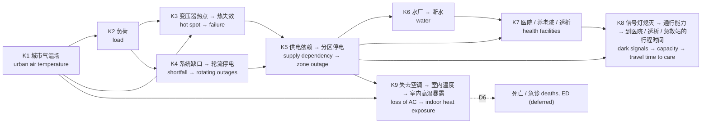

# 精简主线模型（骨架）Core skeleton model

2026-11-03 · 代码 Code：[`pipeline/twin/core.py`](../pipeline/twin/core.py)、[`pipeline/core.py`](../pipeline/core.py) · 组成清单 Manifest：[`twin/core.yaml`](../twin/core.yaml)

## 1. 目的与副本 Purpose and the preserved full model

**中文：** 完整模型（v0 + 2026-10-30 的四个模块）把很多关系都接了进来，但其中不少环节的参数是占位值，而且彼此叠加，结果很难解释。骨架模型只保留文献证据最强、从气温到人群受害不可缺少的一条主线，其余环节暂缓，代码不删。完整模型原样保留在 git 分支 `full-model`、标签 `full-model-v1`（提交 `04eb531`）；在 main 上它仍可用 `python -m pipeline.cascade` 运行。

**English:** The full model (v0 plus the four modules of 2026-10-30) wires in many relations, several with placeholder parameters that compound and make results hard to interpret. The core keeps only the chain that the literature supports most strongly and that cannot be cut without breaking the path from air temperature to harm. Everything else is deferred with its code kept. The full model is preserved unchanged on git branch `full-model`, tag `full-model-v1` (commit `04eb531`), and still runs on main as `python -m pipeline.cascade`.

## 2. 选取原则 Selection rule

**中文：** 一个环节进入骨架，需要同时满足：
1. 文献把它记录为"热浪期间高温 → 停电 → 人群受害"链条上的一环；
2. 去掉它，从气温到结局的链条就断了；
3. 用现有数据就能运行。

属于二阶效应、所用机制被文献质疑、或在我们自己的数据中没有作用的环节暂缓。

**English:** A link enters the core only if all three hold:
1. The literature documents it as part of the heat → outage → harm pathway during heat waves.
2. Removing it would cut the chain from air temperature to the outcome.
3. It runs on data we already hold.

Second-order effects, mechanisms the literature warns against, and links that showed no effect in our own data are deferred.

## 3. 骨架 Skeleton



| 环节 Link | 内容 Content | 方法 / 公式 Method | 参数 Parameters | 文献依据 Evidence |
| --- | --- | --- | --- | --- |
| K1 | 城市气温场 θ_A(x,t) / urban air-temperature field | M-6 | — | shandas2019, ho2014 |
| K2 | 气温 → 负荷 / air temperature → load | Eq. 2–3 | C-P1, C-P1.T0, C-P1.Kd, C-P1.Td | auffhammer2017, bartos2016 |
| K3 | 热点温度 → 热失效 / hot spot → thermal failure | Eq. 4–7 | C-P2.*, C-P3, C-P3.sigma | ieee_c5791_2011, bartos2016, shinozuka2000 |
| K4 | 系统缺口 → 轮流停电（负荷侧）/ shortfall → rotating outages (demand side) | M-18 | C-P9.avail, C-P9.imp | auffhammer2017, eia860, eia930 |
| K5 | 供电依赖、分区、固定修复 / supply dependency, zones, fixed repair | Eq. 9–10, 14 | C-P5, C-P6, C-POP1 | buldyrev2010, rinaldi2001 |
| K6 | 水厂失电 → 储水耗尽 / plant power loss → storage exhausted | Eq. 13 | C-W1, C-W2, C-W3 | rinaldi2001, klise2017 |
| K7 | 医院、养老院（备用）；透析（电 ∨ 水）/ facilities | Eq. 11 | C-H1, C-H2, C-H3 | cms2016, kelman2015, anderson2012 |
| K8 | 信号灯熄灭 → 通行能力 → 到医院、透析中心、急救站的行程时间 / dark signals → capacity → travel time to care | Eq. 11, 16, M-28, M-29 | C-T2, C-T3, C-T5, C-T6.* | rinaldi2001, ouyang2014, hcm2022, bpr1964, kelman2015 |
| K9 | 失去空调 → 室内温度 → 暴露 / loss of AC → indoor heat exposure | M-32, M-33 | C-B1–C-B4, C-H10 | stone2023, sun2020 |

**中文：** K8 是交通系统保留的主线：它是交通环节中唯一直接连到健康结局的一条（停电 → 信号灯 → 到医疗服务的时间），而且透析中心停电后患者必须转去别处（Kelman 等 2015）。与完整模型不同，K8 按每次运行在其最坏小时的实际状态计算，保留尾部情形。

**English:** K8 is the transport link kept in the core: it is the one transport pathway that reaches a health outcome (outage → signals → time to care), and patients of a closed dialysis centre must travel elsewhere (Kelman et al. 2015). Unlike the full model, K8 is computed per run at that run's worst hour, so tail cases are kept.

**中文：** K9 是这次新加的一环，也是骨架的结局。Stone 等（2023）发现热浪期间的多日停电使高温死亡率增加一倍以上，机制就是失去制冷后的室内温度，所以骨架停在"室内高温暴露人·小时"上，而不是用室外气温阈值（完整模型的 C-POP2）。

**English:** K9 is new and is the core's endpoint. Stone et al. (2023) found that a multiday blackout during a heat wave more than doubles heat-related mortality, through indoor temperature once cooling is lost. The core therefore ends at indoor heat person-hours rather than an outdoor threshold (C-POP2 in the full model).

## 4. 公式 Equations

**中文：** K2–K8 与完整模型的 Eq. 2–16 相同（见 [`HANDBOOK.md`](HANDBOOK.md) §4），只有两处差别：
- 标幺负荷不再加上邻站转来的负荷；
- 供电依赖迭代里没有过载跳闸。

**English:** K2–K8 follow Eq. 2–16 of the full model ([`HANDBOOK.md`](HANDBOOK.md) §4) with two differences:
- the per-unit load no longer includes load transferred from neighbours;
- the supply-dependency fixed point has no overload trips.

```math
K_s(t)=K_d\,\frac{1+\beta\max(0,T_s(t)-T_0)}{1+\beta\max(0,T_d-T_0)},\qquad
e_s(t)=\neg f_s(t)\wedge\neg\mathrm{shed}_s(t)\wedge\Big(\neg\exists u\to s\ \vee\ \bigvee_{u\to s}e_u(t)\Big)
```

**K8（M-28、M-29）：** 每次运行 $`r`$ 取其降级路段最多的小时 $`h_r`$。受控路段的通行能力乘以该次运行抽到的 $`\varphi_{dark}`$（C-T5），停电的医院与透析中心不再作为目的地；行程时间增量相对同一小时的正常情况计算（BPR 路段延误，TMAS 工作日小时曲线；路段容量参数取中值）。

**K8 (M-28, M-29):** For each run $`r`$, take its hour $`h_r`$ with the most degraded segments. Capacities of controlled segments are multiplied by that run's $`\varphi_{dark}`$ (C-T5) and closed hospitals and dialysis centres are removed as destinations. The increase is taken against the normal time at the same hour (BPR link delay, TMAS weekday profile, mid lane capacities).

```math
\Delta\tau_{c,k}(r)=\min_{f\in F_k\setminus D_r}SP_{\varphi_r}\big(c,f;h_r\big)-\min_{f\in F_k}SP_{1}\big(c,f;h_r\big),\qquad
\overline{\Delta\tau}_k(r)=\frac{\sum_c \mathrm{pop}_c\,\Delta\tau_{c,k}(r)}{\sum_c \mathrm{pop}_c}
```

**K9（M-32、M-33）：** 有电且有空调时室内为 $`T_{set}`$；停电时以热时间常数 $`\tau_b`$ 趋向平衡温度；无空调住户始终自由升温。白天（当地 08:00–20:00）得热温升为 $`\Delta T_{gain}`$，夜间为 1 K。

**K9 (M-32, M-33):** A powered home with AC stays at $`T_{set}`$; during an outage it relaxes towards the equilibrium with time constant $`\tau_b`$. Homes without AC always free-run. The gain lift is $`\Delta T_{gain}`$ by day (local 08:00–20:00) and 1 K at night.

```math
T^{eq}_z(t)=\theta_A(z,t)+\Delta T_{gain}(t),\qquad
T^{AC}_{in,z}(t)=\begin{cases}T_{set} & e_z(t)\\ T^{eq}_z(t)+\big[T^{AC}_{in,z}(t-1)-T^{eq}_z(t)\big]e^{-1/\tau_b} & \neg e_z(t)\end{cases}
```

```math
E^{out}_g=\sum_t\sum_z f_{AC}\,\mathrm{pop}_{z,g}\,\mathbf 1\big[\neg e_z(t)\wedge T^{AC}_{in,z}(t)\ge T_{thr}\big],\qquad
E^{noAC}=\sum_t\sum_z (1-f_{AC})\,\mathrm{pop}_z\,\mathbf 1\big[T^{noAC}_{in,z}(t)\ge T_{thr}\big]
```

**中文：** $`E^{out}`$ 是级联造成的室内暴露（只在停电时出现），按全体、65 岁以上、贫困人口分别统计；$`E^{noAC}`$ 是与停电无关的背景暴露，用来衡量级联的相对大小。

**English:** $`E^{out}`$ is the indoor exposure caused by the cascade (outage hours only), reported for everyone, people aged 65+ and people below the poverty line. $`E^{noAC}`$ is the background exposure unrelated to outages, used as a yardstick.

| 参数 Parameter | 符号 Symbol | 低 / 中 / 高 Low / mid / high | 依据 Basis |
| --- | --- | --- | --- |
| C-B1 | $`\tau_b`$ (h) | 5 / 15 / 40 | assumption (sun2020) |
| C-B2 | $`\Delta T_{gain}`$ (K) | 1 / 3 / 6 | assumption (sun2020) |
| C-B3 | $`T_{set}`$ (°C) | 23 / 24 / 25 | assumption |
| C-B4 | $`f_{AC}`$ | 0.85 / 0.92 / 0.97 | assumption（待 AHS Nashville / AHS to be added） |
| C-H10 | $`T_{thr}`$ (°C) | 26 / 28 / 32 | assumption (stone2023) |

## 5. 暂缓的细节 Deferred details

| 编号 Id | 细节 Detail | 暂缓理由 Reason | 加回方式 How it returns |
| --- | --- | --- | --- |
| D1 | 同电压站负荷转移与过载跳闸（Motter–Lai，C-P4）/ peer transfer and overload trips | 纯拓扑的负荷重分配可能误判电网脆弱性（hines2010）；真实连锁服从潮流（dobson2007）。完整模型中约 91% 的停电人·小时来自这一机制，而容忍度 α 是假设值。Topological redistribution can mislead; it produced ~91% of person-hours in the full model with an assumed α. | 有额定值后以直流潮流加回（R-P5 2–3 级）/ as DC power flow once ratings exist |
| D2 | 河温 → 火电降额（K4 供给侧）/ river derating | 2014–2025 年模拟河温最高 27.3 °C，低于阈值；各情景降额相同。Modelled river temperature never reached the threshold. | 打开 M-18 供给侧（代码在 `pipeline/twin/river.py`）/ enable the supply side of M-18 |
| D3 | 路面高温病害 / pavement distress | 长期养护成本路径，不是急性级联；LST 指标不优于路段长度。Long-run cost pathway; LST score did not beat segment length. | 有 PG 等级与路面温度后（M-10、M-17）/ with PG grades and M-10, M-17 |
| D5 | 室外复合暴露阈值（C-POP2）/ outdoor compound threshold | 由 K9 取代。Replaced by K9. | — |
| D6 | 归因死亡与急诊（M-34）/ attributable deaths and ED visits | 需要 Nashville 温度–死亡曲线与基线死亡数（HLT-13、HLT-14）。Needs local exposure–response and baseline deaths. | 以 K9 的室内暴露为输入 / takes K9 exposure as input |
| D7 | 修复过程（M-16）/ restoration process | 等 NES 修复记录。Awaits NES restoration records. | 替换 C-P6 / replaces C-P6 |
| D8 | 配电变压器、线路载流量、水力、依赖电力设备者、透析转诊、避暑中心 / other refinements | 需要尚未获得的数据。Need data we do not hold. | 见 [`PIPELINE_SPEC.md`](PIPELINE_SPEC.md) §8 |

## 6. 首次结果 First results

运行 Run `core-20261103T183128Z-553fa444cb`：2023 年 6–8 月，2,000 次蒙特卡洛，城市气温场开启，与完整模型 `cascade-20261030T210232Z-45a0e28623` 使用相同的随机种子。

Run `core-20261103T183128Z-553fa444cb`: June–August 2023, 2,000 Monte Carlo runs, urban air field on, same seed as the full-model run `cascade-20261030T210232Z-45a0e28623`.

| 指标 Output（均值 mean） | +0 °C | +2 °C | +4 °C |
| --- | --- | --- | --- |
| 有停电的运行比例 runs with any outage | 12.0% | 38.1% | 79.9% |
| 停电人·小时（骨架）person-hours without power (core) | 34k | 320k | 1.73M |
| 停电人·小时（完整模型）(full model) | 386k | 3.17M | 16.05M |
| 失去空调人·小时 person-hours without AC due to outages | 31k | 292k | 1.59M |
| 其中室内超过阈值 of which indoor ≥ threshold, $`E^{out}`$ | 4.0k | 67k | 567k |
| 65 岁以上 aged 65+ | 374 | 6.3k | 53k |
| 贫困人口 below poverty | 727 | 12k | 102k |
| 背景暴露（无空调住户）background, $`E^{noAC}`$ | 6.7M | 13.0M | 18.3M |
| TVA 缺口运行比例 runs with a TVA shortfall | 0 | 8.7% | 60.7% |
| K8：有路段降级的运行 runs with degraded segments | 11.5% | 36.9% | 78.8% |
| K8：到医院平均时间增量（p99）hospital Δ, population mean (p99) | 0.003 (0.06) min | 0.013 (0.15) min | 0.046 (0.28) min |
| K8：增加最多的网格（p95）largest cell increase, hospital (p95) | 0.4 min | 1.2 min | 2.0 min |
| K8：到透析中心平均时间增量（p99）dialysis Δ (p99) | 0.03 (1.6) min | 0.15 (1.8) min | 0.46 (5.3) min |
| K8：研究区内没有可用透析中心的运行 runs with no dialysis centre available | 0 | 1.1% | 9.3% |
| K8：到急救站平均时间增量（p99）EMS Δ (p99) | 0.002 (0.04) min | 0.007 (0.06) min | 0.023 (0.10) min |

**中文：**
- **过载转移主导了完整模型。** 去掉 D1 后，停电人·小时在三个情景下都减少约 89–91%。完整模型的停电规模主要由一个参数为假设值、且被文献质疑的机制决定；在有潮流模型之前，骨架的数字更可辩护。
- **室内暴露随升温非线性放大。** 失去空调的人·小时里，室内超过阈值的比例从 +0 °C 的 13% 升到 +4 °C 的 36%：温度越高，停电越可能真正造成危害。这与 Stone 等（2023）"停电叠加热浪"的定性结论一致。
- **级联暴露远小于"没有空调"的背景暴露。** 在 +0 °C 下，$`E^{noAC}`$ 是 $`E^{out}`$ 的上千倍。这个比值强烈依赖占位参数（$`f_{AC}`$、$`\tau_b`$、$`T_{thr}`$），但它说明空调普及率和室内阈值是下一步最值得获取的数据。
- **交通环节：设施停电比堵车更重要。** 信号灯熄灭本身让到医院、急救站的平均时间只增加零点几分钟；即使在 99% 分位，到医院的平均增量也不到 0.3 分钟，增加最多的网格约 2–3 分钟。到透析中心的时间变化大得多，因为它来自设施停电（K7）而不是拥堵：+4 °C 时 9.3% 的运行在最坏小时研究区内没有可用的透析中心。注意 BPR 只算路段延误，不算信号灯熄灭后路口全向停车的延误，所以拥堵部分是下限。
- **敏感性**仍由变压器参数主导：C-P1.Kd ρ = 0.41、C-P3.sigma 0.28、C-P3 −0.21；它们都是占位值。
- **验证：** 模型与 EAGLE-I 逐小时停电的相关 ρ = 0.054 [−0.057, 0.165]，与完整模型一样没有信号，原因相同（县级停电由风暴主导）。

**English:**
- **Overload transfer dominated the full model.** Without D1, person-hours without power fall by about 89–91% in every scenario. The full model's outage scale was set mainly by a mechanism with an assumed parameter that the literature questions; until a power-flow model exists, the core numbers are easier to defend.
- **Indoor exposure grows non-linearly with warming.** The share of AC-loss person-hours with indoor temperature above the threshold rises from 13% at +0 °C to 36% at +4 °C, consistent with the qualitative finding of Stone et al. (2023).
- **Cascade exposure is small next to the no-AC background.** At +0 °C, $`E^{noAC}`$ is over a thousand times $`E^{out}`$. The ratio depends heavily on placeholders ($`f_{AC}`$, $`\tau_b`$, $`T_{thr}`$), which makes AC prevalence and the indoor threshold the most valuable data to obtain next.
- **Transport: facility outages matter more than congestion.** Dark signals alone add only fractions of a minute to mean travel time to hospitals and EMS; even at the 99th percentile the hospital mean rises by under 0.3 min, and the worst cell by about 2–3 min. Dialysis access changes far more because it is driven by facility outages (K7): at +4 °C, 9.3% of runs have no dialysis centre available in the AOI at their worst hour. BPR counts link delay only, not all-way-stop delay at dark intersections, so the congestion part is a lower bound.
- **Sensitivity** is still led by transformer placeholders: C-P1.Kd ρ = 0.41, C-P3.sigma 0.28, C-P3 −0.21.
- **Validation:** ρ(model, EAGLE-I hourly) = 0.054 [−0.057, 0.165]; no signal, as in the full model, because county outages are storm-driven.

## 7. 加回细节的规程 Protocol for adding a detail back

**中文：**
1. 在 `pipeline/twin/core.py` 里以函数或开关实现该细节，默认关闭；
2. 在 `twin/core.yaml` 中把它从 `deferred` 移到 `links`，写明证据；
3. 运行 `python -m pipeline.registry` 检查编号；
4. 开、关各跑一次 `python -m pipeline.core`，在 RESULTS.md 记录差异；
5. 只有当差异有数据或文献支持时才默认打开。

**English:**
1. Implement the detail in `pipeline/twin/core.py` as a function or switch, off by default.
2. Move it from `deferred` to `links` in `twin/core.yaml` with its evidence.
3. Run `python -m pipeline.registry`.
4. Run `python -m pipeline.core` with it on and off and record the difference in RESULTS.md.
5. Turn it on by default only when data or literature support the difference.

## 8. 命令 Commands

```
.venv/bin/python -m pipeline.build                     # 参数表改动后重建 / after editing twin/couplings.csv
.venv/bin/python -m pipeline.core --runs 2000           # 骨架模型 / core model (~3 min)
.venv/bin/python -m pipeline.cascade --runs 2000        # 完整模型 / full model
.venv/bin/python -m pipeline.report                     # RESULTS.md（含 §11 骨架 / incl. §11 core）
.venv/bin/python -m pipeline.registry                   # 登记表与 core.yaml 检查 / registry and core.yaml check
```
