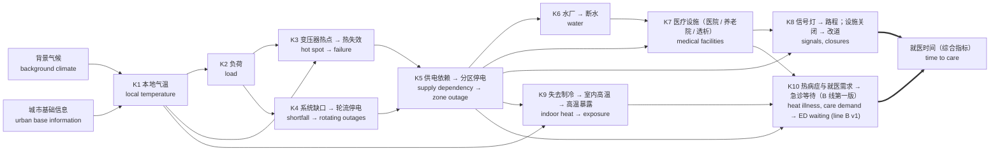

# 精简主线模型（骨架）Core skeleton model

2026-11-03 · 代码 Code：[`pipeline/twin/core.py`](../pipeline/twin/core.py)、[`pipeline/core.py`](../pipeline/core.py) · 组成清单 Manifest：[`twin/core.yaml`](../twin/core.yaml)

## 0. 结构调整 Structure revision (2026-11-10)

**中文：**
- **气候层只保留两个节点。** 背景气候（气温、地表温度、河温）和城市基础信息（城市热分布，目前是 2022 年走航测温的气温场）。之后会拿到一份完整的历史数据包；在那之前，模拟继续用现有记录（BNA 2014–2025、2023 年地表温度、模拟河温）。
- **暂不考虑经济损失。** D9 经济损失和 D3 车辙成本标为暂停，代码、变量和证据保留。
- **结局层围绕两条线组织，都以就医时间为综合指标。** 医院、养老院、透析中心合并为"医疗设施"一层，各自保留备用规则。A 线：电、水、交通影响医疗设施和路程，使就医时间增加（K6–K8，已模拟）。B 线：高温使热相关病症和就医人数增加，需求超过设施容量时产生等待，同样拉长就医时间（K10，2026-11-11 起第一版已模拟）。就医时间 = 路程时间 + 等待时间。

**English:**
- **The climate layer keeps two nodes:** background climate (air temperature, land surface temperature, river temperature) and urban base information (the city's heat pattern, now the 2022 traverse field). A complete historical package will replace the current records (BNA 2014–2025, 2023 LST, modelled river temperature); until then the model runs on them.
- **Economic loss is paused.** D9 economic loss and D3 rutting cost are marked paused; code, variables and evidence are kept.
- **The outcome layer is organised around two lines that both end in time to care.** Hospitals, nursing homes and dialysis centres form one medical-facility layer with their own backup rules. Line A: power, water and transport disrupt facilities and the trip, raising time to care (K6–K8, simulated). Line B: heat raises heat-related illness and the number of people seeking care; demand beyond capacity adds waiting (K10, simulated as v1 since 2026-11-11). Time to care = travel time + waiting time.

## 1. 目的与副本 Purpose and the preserved full model

**中文：** 完整模型（v0 + 2026-10-30 的四个模块）把很多关系都接了进来，但其中不少环节的参数是占位值，而且彼此叠加，结果很难解释。骨架模型只保留文献证据最强、从气温到人群受害不可缺少的一条主线，其余环节暂缓，代码不删。完整模型原样保留在 git 分支 `full-model`、标签 `full-model-v1`（提交 `04eb531`）；在 main 上它仍可用 `python -m pipeline.cascade` 运行。

**English:** The full model (v0 plus the four modules of 2026-10-30) wires in many relations, several with placeholder parameters that compound and make results hard to interpret. The core keeps only the chain that the literature supports most strongly and that cannot be cut without breaking the path from air temperature to harm. Everything else is deferred with its code kept. The full model is preserved unchanged on git branch `full-model`, tag `full-model-v1` (commit `04eb531`), and still runs on main as `python -m pipeline.cascade`.

## 2. 选取原则 Selection rule

**中文：** 一个环节进入骨架，需要同时满足：
1. 文献把它记录为"热浪期间高温 → 停电 → 人群受害"链条上的一环；
2. 去掉它，从气温到结局的链条就断了；
3. 用现有数据就能运行。

属于二阶效应、所用机制被文献质疑、或在我们自己的数据中没有作用的环节暂缓。

**English:** A link enters the core only if all three hold:
1. The literature documents it as part of the heat → outage → harm pathway during heat waves.
2. Removing it would cut the chain from air temperature to the outcome.
3. It runs on data we already hold.

Second-order effects, mechanisms the literature warns against, and links that showed no effect in our own data are deferred.

## 3. 骨架 Skeleton



| 环节 Link | 内容 Content | 方法 / 公式 Method | 参数 Parameters | 文献依据 Evidence |
| --- | --- | --- | --- | --- |
| K1 | 城市气温场 θ_A(x,t) / urban air-temperature field | M-6 | — | shandas2019, ho2014 |
| K2 | 气温 → 负荷 / air temperature → load | Eq. 2–3 | C-P1, C-P1.T0, C-P1.Kd, C-P1.Td | auffhammer2017, bartos2016 |
| K3 | 热点温度 → 热失效 / hot spot → thermal failure | Eq. 4–7 | C-P2.*, C-P3, C-P3.sigma | ieee_c5791_2011, bartos2016, shinozuka2000 |
| K4 | 系统缺口 → 轮流停电（负荷侧）/ shortfall → rotating outages (demand side) | M-18 | C-P9.avail, C-P9.imp | auffhammer2017, eia860, eia930 |
| K5 | 供电依赖、分区、固定修复 / supply dependency, zones, fixed repair | Eq. 9–10, 14 | C-P5, C-P6, C-POP1 | buldyrev2010, rinaldi2001 |
| K6 | 水厂失电 → 储水耗尽 / plant power loss → storage exhausted | Eq. 13 | C-W1, C-W2, C-W3 | rinaldi2001, klise2017 |
| K7 | 医院、养老院（备用）；透析（电 ∨ 水）/ facilities | Eq. 11 | C-H1, C-H2, C-H3 | cms2016, kelman2015, anderson2012 |
| K8 | 信号灯熄灭 → 通行能力 → 到医院、透析中心、急救站的行程时间 / dark signals → capacity → travel time to care | Eq. 11, 16, M-28, M-29 | C-T2, C-T3, C-T5, C-T6.* | rinaldi2001, ouyang2014, hcm2022, bpr1964, kelman2015 |
| K9 | 失去空调 → 室内温度 → 暴露 / loss of AC → indoor heat exposure | M-32, M-33 | C-B1–C-B4, C-H10 | stone2023, sun2020 |
| K10 | B 线：热病症、养老院住户、依赖电力设备的居民 → 就医需求 → 急诊等待 / line B: heat illness, nursing homes, device users → care demand → ED waiting | M-47 | C-H11–C-H17 | tdh_hri_ed, hhs_empower, lin2011, meade2024 |

**中文：** K8 是交通系统保留的主线：它是交通环节中唯一直接连到健康结局的一条（停电 → 信号灯 → 到医疗服务的时间），而且透析中心停电后患者必须转去别处（Kelman 等 2015）。与完整模型不同，K8 按每次运行在其最坏小时的实际状态计算，保留尾部情形。

**English:** K8 is the transport link kept in the core: it is the one transport pathway that reaches a health outcome (outage → signals → time to care), and patients of a closed dialysis centre must travel elsewhere (Kelman et al. 2015). Unlike the full model, K8 is computed per run at that run's worst hour, so tail cases are kept.

**中文：** K9 是这次新加的一环，也是骨架的结局。Stone 等（2023）发现热浪期间的多日停电使高温死亡率增加一倍以上，机制就是失去制冷后的室内温度，所以骨架停在"室内高温暴露人·小时"上，而不是用室外气温阈值（完整模型的 C-POP2）。

**English:** K9 is new and is the core's endpoint. Stone et al. (2023) found that a multiday blackout during a heat wave more than doubles heat-related mortality, through indoor temperature once cooling is lost. The core therefore ends at indoor heat person-hours rather than an outdoor threshold (C-POP2 in the full model).

## 4. 公式 Equations

**中文：** K2–K8 与完整模型的 Eq. 2–16 相同（见 [`HANDBOOK.md`](HANDBOOK.md) §4），只有两处差别：
- 标幺负荷不再加上邻站转来的负荷；
- 供电依赖迭代里没有过载跳闸。

**English:** K2–K8 follow Eq. 2–16 of the full model ([`HANDBOOK.md`](HANDBOOK.md) §4) with two differences:
- the per-unit load no longer includes load transferred from neighbours;
- the supply-dependency fixed point has no overload trips.

```math
K_s(t)=K_d\,\frac{1+\beta\max(0,T_s(t)-T_0)}{1+\beta\max(0,T_d-T_0)},\qquad
e_s(t)=\neg f_s(t)\wedge\neg\mathrm{shed}_s(t)\wedge\Big(\neg\exists u\to s\ \vee\ \bigvee_{u\to s}e_u(t)\Big)
```

**K8（M-28、M-29）：** 每次运行 $`r`$ 取其降级路段最多的小时 $`h_r`$。受控路段的通行能力乘以该次运行抽到的 $`\varphi_{dark}`$（C-T5），停电的医院与透析中心不再作为目的地；行程时间增量相对同一小时的正常情况计算（BPR 路段延误，TMAS 工作日小时曲线；路段容量参数取中值）。

**K8 (M-28, M-29):** For each run $`r`$, take its hour $`h_r`$ with the most degraded segments. Capacities of controlled segments are multiplied by that run's $`\varphi_{dark}`$ (C-T5) and closed hospitals and dialysis centres are removed as destinations. The increase is taken against the normal time at the same hour (BPR link delay, TMAS weekday profile, mid lane capacities).

```math
\Delta\tau_{c,k}(r)=\min_{f\in F_k\setminus D_r}SP_{\varphi_r}\big(c,f;h_r\big)-\min_{f\in F_k}SP_{1}\big(c,f;h_r\big),\qquad
\overline{\Delta\tau}_k(r)=\frac{\sum_c \mathrm{pop}_c\,\Delta\tau_{c,k}(r)}{\sum_c \mathrm{pop}_c}
```

**K9（M-32、M-33）：** 有电且有空调时室内为 $`T_{set}`$；停电时以热时间常数 $`\tau_b`$ 趋向平衡温度；无空调住户始终自由升温。白天（当地 08:00–20:00）得热温升为 $`\Delta T_{gain}`$，夜间为 1 K。

**K9 (M-32, M-33):** A powered home with AC stays at $`T_{set}`$; during an outage it relaxes towards the equilibrium with time constant $`\tau_b`$. Homes without AC always free-run. The gain lift is $`\Delta T_{gain}`$ by day (local 08:00–20:00) and 1 K at night.

```math
T^{eq}_z(t)=\theta_A(z,t)+\Delta T_{gain}(t),\qquad
T^{AC}_{in,z}(t)=\begin{cases}T_{set} & e_z(t)\\ T^{eq}_z(t)+\big[T^{AC}_{in,z}(t-1)-T^{eq}_z(t)\big]e^{-1/\tau_b} & \neg e_z(t)\end{cases}
```

```math
E^{out}_g=\sum_t\sum_z f_{AC}\,\mathrm{pop}_{z,g}\,\mathbf 1\big[\neg e_z(t)\wedge T^{AC}_{in,z}(t)\ge T_{thr}\big],\qquad
E^{noAC}=\sum_t\sum_z (1-f_{AC})\,\mathrm{pop}_z\,\mathbf 1\big[T^{noAC}_{in,z}(t)\ge T_{thr}\big]
```

**中文：** $`E^{out}`$ 是级联造成的室内暴露（只在停电时出现），按全体、65 岁以上、贫困人口分别统计；$`E^{noAC}`$ 是与停电无关的背景暴露，用来衡量级联的相对大小。

**English:** $`E^{out}`$ is the indoor exposure caused by the cascade (outage hours only), reported for everyone, people aged 65+ and people below the poverty line. $`E^{noAC}`$ is the background exposure unrelated to outages, used as a yardstick.

| 参数 Parameter | 符号 Symbol | 低 / 中 / 高 Low / mid / high | 依据 Basis |
| --- | --- | --- | --- |
| C-B1 | $`\tau_b`$ (h) | 5 / 12 / 40 | literature-informed placeholder (wijesuriya2024, sun2020, leigh2014) |
| C-B2 | $`\Delta T_{gain}`$ (K) | 2 / 4 / 7 | literature-informed placeholder (sun2020, leigh2014) |
| C-B3 | $`T_{set}`$ (°C) | 21 / 22.5 / 24.5 | literature (eia_recs2020) |
| C-B4 | $`f_{AC}`$ | 0.90 / 0.94 / 0.98 | literature (eia_recs2020, census_lace2023) |
| C-H10 | $`T_{thr}`$ (°C) | 26 / 28 / 32 | literature (meade2024, huizenga2024) |

### 4.1 参数取值与数据来源 Parameter values and sources (2026-11-04)

【中文】下表是 2026-11-04 用公开数据替换的骨架参数。「来源等级」：**A** 本地实测或官方统计直接给出；**B** 由官方数据或文献换算（换算是本项目自己做的，写在「换算」一栏）；**C** 文献模拟或从图中读数；**D** 新闻、二手引用或推断，需尽快核实。每条的原文出处与页码、表号写在 [`twin/couplings.csv`](../twin/couplings.csv) 的 `evidence` 列，文献条目在 [`twin/references.yaml`](../twin/references.yaml)。

English: core parameters replaced with public data on 2026-11-04. Source grade: **A** stated directly by local measurements or official statistics; **B** derived from official data or literature (the derivation is this project's own, shown in the "Derivation" column); **C** simulation studies or values read from figures; **D** news, secondary citations or inference, to be verified. Page and table locators are in the `evidence` column of [`twin/couplings.csv`](../twin/couplings.csv); entries are in [`twin/references.yaml`](../twin/references.yaml).

| 参数 Parameter | 旧值 Old | 新值 New | 等级 Grade | 来源 Source (locator) | 换算 Derivation |
| --- | --- | --- | --- | --- | --- |
| C-P6 修复时长 repair hours (h) | 4 / 8 / 24 | 1 / 3 / 12 | B | eaglei2023, Davidson 2015–2025 excl. 2018; `scripts/eaglei_restoration.py` | Non-storm events > 3,000 customers, ≥ 30 min (n = 278): q50 1.38 h, q90 5.25 h; storm q90 12.8 h. Customer outage time incl. switching |
| C-P9.avail TVA 可用容量比例 available share | 0.82 / 0.88 / 0.93 | 0.83 / 0.90 / 0.95 | B | nerc_sra 2022–2026 (risk-scenario table, SERC-Central); tva10k FY2023 | (1 + typical-outage margin)/(1 + anticipated margin) = 0.924–0.958; Elliott ≈ 0.81. SERC-Central ⊃ TVA |
| C-P9.imp 净输入 net import (MW) | 0 / 1,500 / 3,000 | 1,000 / 4,000 / 6,900 | A/B | eia930 TVA 2016–2025 Jun–Sep; nerc_itcs2024 (ETI07, p. 64) | Peak-hour net import 4,282 / 5,716 / 5,067 MW (2023–25); transfer capability 6,878 MW |
| C-H1 医院备用电源失效 hospital backup fails | 0.02 / 0.05 / 0.15 | 0.01 / 0.05 / 0.15 | B/D | marqusee2020 (Tables 2–4); irvinbarnwell2020; klinger2014 (secondary); hhs_oig_sandy2014 (p. 13) | Failure to start 0.13–1.65%; disasters 6–11% |
| C-H2 养老院无法维持制冷 nursing home cannot keep cooling | 0.10 / 0.30 / 0.50 | unchanged | D | hhs_oig_nh2026; tn_0720_18 | 73% of homes with power-system deficiencies; TN does not require generator cooling. No measured rate |
| C-W2 水厂备用电源失效 plant backup fails | 0.05 / 0.15 / 0.30 | 0.02 / 0.05 / 0.15 | B | metrowater2024 (p. 6); marqusee2020 | Four generators per plant; Harrington runs 72 of 90 MGD on backup |
| C-W3 储水时长 storage (h) | 6 / 12 / 24 | 5 / 10 / 18 (2026-11-10) | B | metrowater2024 (pp. 6–7); MWS commercial-paper memorandum Dec 2025 | 51.7 MG in service (98.3 MG was a drafting inconsistency) ÷ 109.5–137.8 MGD = 9–11 h; ~84 MG after the 8th Ave rebuild = 15–18 h; usable share ~50% assumed for the low end |
| C-T2 无电池信号灯比例 signals without battery | 0.50 / 0.75 / 1.00 | 0.75 / 0.90 / 1.00 | D | wsmv2025 (news); nysdot2009 (pp. 19–25) | 36 of ~600 signals with batteries (~6%). Battery hours 2–8 h not modelled |
| C-T5 熄灯通行能力系数 dark-signal capacity factor | 0.40 / 0.50 / 0.70 | 0.35 / 0.50 / 0.65 | B | french1956 (pp. 22, 27–28); kyte1994 (p. 111); alkaisy2023 | 500 veh/h/lane ÷ (1,750 × 0.45 green) ≈ 0.6; lower on multilane arterials |
| C-B1 τ_b (h) | 5 / 15 / 40 | 5 / 12 / 40 | C | wijesuriya2024 (Fig. 7); sun2020 (Fig. 4); leigh2014 (Fig. 4) | No fitted τ published; own fit to Leigh Fig. 4 gives 6–12 h |
| C-B2 ΔT_gain (K) | 1 / 3 / 6 | 2 / 4 / 7 | C | sun2020 (Figs. 4, 12); leigh2014 (Fig. 4) | Daily-mean lift 2–5 K read from figures; night lift 5–7 K (model keeps 1 K) |
| C-B3 T_set (°C) | 23 / 24 / 25 | 21 / 22.5 / 24.5 | A | eia_recs2020 HC7.8 (East South Central) | Median daytime setting 71–73 °F |
| C-B4 f_AC | 0.85 / 0.92 / 0.97 | 0.90 / 0.94 / 0.98 | A | eia_recs2020 (TN 93%); census_lace2023 (Davidson 97.7%, tracts 89.7–100%) | — |
| C-H10 T_thr (°C) | 26 / 28 / 32 | unchanged | B | meade2024; huizenga2024 (pp. 7–8) | 26 older adults, 28 general, 32 acute strain |

【中文】仍缺的：NES 变压器额定容量与馈线分区（PWR-03、PWR-20，需合作）、Nashville 信号灯 UPS 清单（向 NDOT 申请）、夜间室内外温差参数化、电池续航时长建模。变电站峰值负荷的公开量级（平均每站约 13 MW，eia861、nes_fiscalfacts）已记入 PWR-04，模型仍用相对负荷。

English: still missing are NES transformer ratings and feeder zones (PWR-03, PWR-20; partner data), the Nashville signal UPS inventory (NDOT request), a night-lift parameter and battery runtime. The public scale of substation peak load (~13 MW mean, eia861, nes_fiscalfacts) is recorded under PWR-04; the model still uses relative loads.

### 4.2 因果贡献：敲除实验 Causal contribution by knockout (2026-11-10)

**中文：** 对关系图集中的每条关系，用相同的随机数分别运行"全部开启"和"只关掉这一条"（do 干预），贡献 = (基准 − 敲除) / 基准。正值表示这条关系放大结局，负值表示它起缓冲作用。结局有三个：A 线的就医时间增量（医院、透析、急救三类设施人口加权的增加分钟数之和，取每次运行最坏的小时）、停电人·小时，以及 B 线的输入"室内高温暴露人·小时"。串联链上任何一环被关掉，下游效果都会消失，所以串联各环的贡献相同，各条的贡献也不能相加。程序：`python -m pipeline.contrib --runs 1000 --scenarios 2,4`，输出 `site/data/twin/core/contrib.json`；结果见第 6 节和关系图集。

**English:** For each relation in the atlas, the core model is run with everything on and with only that relation switched off (a do-intervention), using the same random numbers; contribution = (base − knockout) / base. Positive means the relation adds to the outcome; negative means it buffers. Three outcomes: line A time to care (population-mean added minutes to hospital, dialysis and EMS, summed, at each run's worst hour), person-hours without power, and indoor heat exposure (the input of line B). Switching off any link in a series chain removes everything downstream, so series links share the same contribution and contributions do not add up. Command: `python -m pipeline.contrib --runs 1000 --scenarios 2,4`; output `site/data/twin/core/contrib.json`.

**K8 的两处修正 Two changes to K8 (2026-11-10):**
- 每次运行的"最坏小时"原来只按降级路段数选，改为降级路段数加关闭的医院与透析中心（每家记 500），使有设施关闭的小时优先。否则关掉信号灯时找不到最坏小时，设施关闭的影响也会被漏算。The worst hour now counts closed hospitals and dialysis centres (500 each) as well as degraded segments; otherwise switching signals off would also hide facility closures.
- 研究区内某类设施全部不可达时，受影响人口按增加 30 分钟计入就医时间（假设：研究区外的设施不在路网中）。Cells that lose every facility of a type inside the area count 30 added minutes (assumption: facilities outside the area are not on the network).
- 每小时都抽取轮流停电的随机数，保证不同敲除之间的随机数对齐。The rotating-outage random draw is made every hour so that knockouts share random numbers.

### 4.3 B 线初步检验 First test of line B (2026-11-10)

**中文：** 田纳西卫生厅公布的 Davidson 每年高温病症急诊人次（2012–2023，T1）与 BNA 当年 5–9 月高温指标在 10 个重叠年份（2014–2023）中正相关：≥35 °C 天数 ρ = 0.73（p = 0.02），日均气温超过 25 °C（Nashville 最低死亡温度）的度日 ρ = 0.67；周边五县合计结果相同。对数线性拟合：每增加 1 个度日，急诊约增加 0.44%（标准误 0.11%），从最凉年（约 110 度日）到最热年（约 230 度日）约多 70%。2020 年偏低，可能与疫情期间回避就医有关。这只说明年度尺度存在信号；B 线需要逐日急诊数据来拟合暴露–反应关系。脚本 `scripts/heat_ed_annual.py`，结果 `twin/evidence/heat_ed_annual.json`。

**English:** Davidson's annual heat-illness ED visits (Tennessee Department of Health, 2012–2023, T1) rise with BNA's May–September heat over the ten overlapping years (2014–2023): days ≥ 35 °C ρ = 0.73 (p = 0.02); degree-days of daily mean above 25 °C (Nashville's minimum-mortality temperature) ρ = 0.67; the five-county total gives the same. A log-linear fit gives about +0.44% visits per degree-day (SE 0.11%), about 70% more visits from the coolest year (~110 degree-days) to the hottest (~230). 2020 is low, probably COVID-19 care avoidance. This shows an annual signal only; line B needs daily ED counts to fit an exposure–response curve. Script `scripts/heat_ed_annual.py`; output `twin/evidence/heat_ed_annual.json`.

### 4.4 核对发现的规则缺口 Rule gaps found in the 2026-11-10 audit

**中文：**
- 轮流停电（K4）随机切除供电站，没有保护医院所在的线路；现实中拉闸限电通常避开关键负荷。
- 急救站（消防站）被假设始终有电，没有对应的停电关系；消防站一般有发电机，但这是假设。
- 信号灯电池只有有 / 无两种状态，没有 2–8 小时的续航。
- 路段通行能力与 BPR 系数（C-T6.*）固定取中值，它们的不确定性不在敏感性分析中。
- 补入 B 线的两条关系：养老院失去制冷 → 住户高温暴露；分区停电 → 依赖电力设备的居民 → 就医需求（2026-11-11 起在 K10 中模拟，见 §4.5）。

**English:**
- Rotating outages (K4) shed serving stations at random and do not protect hospital feeders; real load shedding usually spares critical loads.
- EMS (fire) stations are assumed always powered; there is no outage relation for them.
- Signal batteries are on or off, without 2–8 h of runtime.
- Link capacities and BPR coefficients (C-T6.*) are fixed at mid values, so their uncertainty is not in the sensitivity analysis.
- Two relations added to line B: nursing-home cooling loss → residents' heat exposure; zone outage → electricity-dependent residents → care demand (simulated in K10 since 2026-11-11, §4.5).

### 4.5 研究区扩到全县与 B 线第一版 County extent and line B v1 (2026-11-11)

**中文：** 研究区从市中心方块扩到 Davidson 全县（`datasets.yaml` 的 `aoi` 与 `aoi_polygon`），电力和供水外扩约 4 km；OSM 变电站 / 电力线 / 水务 / 信号灯 / 消防站、3DEP 高程与 NLCD 栅格按全县重新获取；建筑改用 Metro 全县轮廓（328,090 栋）；供电分区按县界裁剪。城市气温场仍由 2022 年走航测温拟合，郊区属于外推。B 线第一版见 PIPELINE_SPEC M-47：热病症就诊按田纳西年度急诊数据校准（`python -m pipeline.lineb calibrate`，R² 0.75），加上养老院住户（CMS）和依赖电力设备的居民（emPOWER），以排队近似换算为急诊等待。**就医时间（2026-11-11 修订）按急诊就诊人次计算**：每位就诊者（日常 + 新增）在高峰日到最近开放医院的路程增量（医院停电时改去下一家）+ 信号灯拥堵增量 + 所去医院的等待增量；各医院分别排队。透析单独计受影响的透析次数。主结果报中位数和 p95（`pipeline/care.py`，PIPELINE_SPEC M-47）。

**English:** The study area moved from the downtown box to Davidson County (`aoi` and `aoi_polygon` in `datasets.yaml`), with power and water extended about 4 km beyond; OSM power, water, signal and fire-station layers and the 3DEP / NLCD grids were re-fetched for the county; buildings now come from Metro's county-wide footprints (328,090); zones are clipped to the county boundary. The urban air field is still fitted on the 2022 traverse, so rural areas are an extrapolation. Line B v1 follows PIPELINE_SPEC M-47: heat-illness visits calibrated on Tennessee annual ED data (R² 0.75), plus nursing-home residents (CMS) and electricity-dependent residents (emPOWER), converted to ED waiting through a queueing approximation. **Time to care (revised 2026-11-11) is per ED visit**: each visitor's added travel to the nearest open hospital on the peak day (rerouted when a hospital is out), plus dark-signal congestion, plus added waiting at per-hospital queues. Dialysis is reported separately as sessions affected. Main results use the median and p95 (`pipeline/care.py`, PIPELINE_SPEC M-47).

## 5. 暂缓的细节 Deferred details

| 编号 Id | 细节 Detail | 暂缓理由 Reason | 加回方式 How it returns |
| --- | --- | --- | --- |
| D1 | 同电压站负荷转移与过载跳闸（Motter–Lai，C-P4）/ peer transfer and overload trips | 纯拓扑的负荷重分配可能误判电网脆弱性（hines2010）；真实连锁服从潮流（dobson2007）。完整模型中 86–92% 的停电人·小时来自这一机制（2026-11-11 全县运行），而容忍度 α 是假设值。Topological redistribution can mislead; it produced 86–92% of person-hours in the full model (county run of 2026-11-11) with an assumed α. | 有额定值后以直流潮流加回（R-P5 2–3 级）/ as DC power flow once ratings exist |
| D2 | 河温 → 火电降额（K4 供给侧）/ river derating | 2014–2025 年模拟河温最高 27.3 °C，低于阈值；各情景降额相同。Modelled river temperature never reached the threshold. | 打开 M-18 供给侧（代码在 `pipeline/twin/river.py`）/ enable the supply side of M-18 |
| D3 | 路面高温 → 车辙 → 铺装成本 / pavement heat → rutting → resurfacing cost | 长期经济路径，不属于急性级联，接到经济损失 D9。HPMS 2024：夏季 LST 每高 1 °C 车辙深约 1.8%（4,269 个路段，R² 0.09，横截面）。A long-run cost pathway feeding D9; HPMS shows rut depth about 1.8% deeper per °C of LST (cross-sectional). | 有单价与多年车辙测量后（M-10、M-45）/ with unit costs and rut survey panels (M-10, M-45) |
| D5 | 室外复合暴露阈值（C-POP2）/ outdoor compound threshold | 由 K9 取代。Replaced by K9. | — |
| D6 | 归因死亡与急诊（M-34）/ attributable deaths and ED visits | 需要 Nashville 温度–死亡曲线与基线死亡数（HLT-13、HLT-14）。Needs local exposure–response and baseline deaths. | 以 K9 的室内暴露为输入 / takes K9 exposure as input |
| D7 | 修复过程（M-16）/ restoration process | 等 NES 修复记录。Awaits NES restoration records. | 替换 C-P6 / replaces C-P6 |
| D8 | 配电变压器、线路载流量、水力及医院 / 养老院用水、依赖电力设备者、透析转诊、避暑中心 / other refinements | 需要尚未获得的数据。医院、养老院在依赖图中连到供水，但骨架只对透析中心使用断水（医院有自备储水，且运行中未出现断水）。Need data we do not hold. Hospitals and nursing homes are linked to water in the graph, but the core applies water loss to dialysis only. | 见 [`PIPELINE_SPEC.md`](PIPELINE_SPEC.md) §8 |
| D9 | 经济损失：用户停电损失、健康结局货币化 / economic loss | 健康之外的第二个结局。停电损失 = 用户·小时 × 供电可靠性价值（sullivan2015）；健康损失 = 归因死亡 × 统计生命价值（usdot_vsl），需等 D6。两者分开报告。The second endpoint besides health; outage cost from customer-hours × value of service reliability, health cost after D6. | 需要 NES 按分区、用户类别的户数 / needs NES customers by class per zone |

## 6. 结果 Results

完整的结果表由程序自动生成，不在这里手抄：[`RESULTS.md`](RESULTS.md) §11（主结果）、§11.1（敲除贡献）、§11.2（B 线假设情景）、§11.3（实际热浪）。重跑 `python -m pipeline.core`、`pipeline.contrib`、`pipeline.contrib --variants` 后执行 `python -m pipeline.report` 即更新；关系图集用 `python scripts/build_atlas.py` 更新。下面只记录解读，数字对应运行 `core-20261111T183212Z-65731ebbe3`（Davidson 全县，2023 年 6–8 月，2,000 次）。

Full result tables are generated, not copied by hand: [`RESULTS.md`](RESULTS.md) §11 (main), §11.1 (knockouts), §11.2 (line B assumption variants), §11.3 (observed heat waves). Rerun the models and `python -m pipeline.report`; the atlas is rebuilt with `python scripts/build_atlas.py`. Below is interpretation only, for run `core-20261111T183212Z-65731ebbe3` (Davidson County, June–August 2023, 2,000 runs).

就医时间 = 每次急诊就诊在各次运行高峰日增加的"路程 + 等待"（§4.5，`pipeline/care.py`），按 中位数（p95；均值）报告。Time to care = added travel plus waiting per ED visit on each run's peak day, reported as median (p95; mean).

| 指标 Output | +0 °C | +2 °C | +4 °C |
| --- | --- | --- | --- |
| 有停电的运行 runs with any outage | 16.1% | 38.4% | 67.6% |
| 停电人·小时 person-hours without power (core, mean) | 62k | 655k | 4.08M |
| 热病症超额就诊 excess heat-illness visits per summer | 121 | 233 | 332 |
| **就医时间 time to care per ED visit, min** | **1.4 (5.8; 3.1)** | **1.8 (47; 12)** | **3.1 (285; 43)** |
| 受影响的透析次数 dialysis sessions affected | 1.0 | 9.6 | 69 |

**中文：**
- **典型情况与最坏情况要分开看。** +4 °C 时一次急诊就诊的中位增量只有约 3 分钟，但 p95 约 285 分钟、均值 43 分钟：少数运行里某几家医院在停电与就诊高峰同时出现时接近满负荷，排队时间急剧上升。均值描述的是这条尾部。
- **路程几乎不变。** 全县 12 家医院，关闭一家后病人改去下一家，平均每次就诊只多 0.01 分钟；信号灯熄灭的拥堵增量均值 0.13 分钟。A 线对就医时间的影响主要通过"医院停电降低急诊容量"进入等待，而不是路程。
- **透析是 A 线最直接的后果。** +4 °C 时每个夏季平均约 69 次透析受影响（取消或改到别处），比"没有可用透析中心"（2.7% 的运行）更能反映规模。
- **验证：** 与 EAGLE-I 县级逐小时停电的相关 ρ = 0.03 [−0.04, 0.12]，仍无信号（县级停电以风暴为主）。电网验证需要 NES 数据（申请信已起草，未发出）。
- **敏感性：** 停电人·小时由 C-P1.Kd（0.44）、C-P3.sigma（0.34）、C-P3（−0.24）主导，都是 T4 假设。

**English:**
- **Typical and worst cases differ.** At +4 °C the median ED visit gains about 3 min, but the p95 is about 285 min and the mean 43 min: in a minority of runs some hospitals approach capacity when outages coincide with the peak in visits. The mean describes this tail.
- **Travel barely changes.** With 12 hospitals county-wide, closures add 0.01 min per visit and dark-signal congestion 0.13 min on average. Line A reaches time to care mainly by cutting ED capacity at hospitals without power, which shows up as waiting.
- **Dialysis is line A's most direct consequence:** about 69 sessions affected per summer at +4 °C, a better measure of scale than "no centre available" (2.7% of runs).
- **Validation:** ρ(model, EAGLE-I hourly) = 0.03 [−0.04, 0.12], still no signal. Grid validation needs NES data (request drafted, not sent).
- **Sensitivity:** person-hours without power are led by C-P1.Kd (0.44), C-P3.sigma (0.34) and C-P3 (−0.24), all T4 assumptions.

### 6.1 因果贡献 Knockout contributions

表见 RESULTS §11.1，图见关系图集（线上的百分比）。方法见 §4.2。Table in RESULTS §11.1; contributions are drawn on the atlas links. Method: §4.2.

**中文：**
- **均值和中位数由不同的链决定。** 关掉依赖电力设备居民的就诊（R24），就医时间均值下降 90%，中位数只降 43%；关掉热病症（R21），均值降 7%，中位数降 72%。也就是说：**典型的等待增加来自热病症（T2 校准），尾部来自停电 → 设备用户（T4 的 q）**。
- **电网链（R02 负荷、R04 热失效）对均值的贡献约 96%，对中位数约 51%**，修复时长（R07）约 73% / 44%，供电依赖（R08）约 47% / 15%。
- **设施关闭（R11）约 8%**，几乎全部通过急诊容量下降进入等待。
- **城市气温场仍是缓冲（约 −11%）**：全县大部分地方比机场凉。
- **供水、系统缺口、养老院对就医时间的贡献接近 0。**

**English:**
- **The mean and the median are driven by different chains.** Switching off visits by electricity-dependent residents (R24) cuts the mean by 90% but the median by 43%; switching off heat illness (R21) cuts the mean by 7% and the median by 72%. **Typical added waiting comes from heat illness (T2 calibration); the tail comes from outages → device users (T4 q).**
- **The grid chain (R02 load, R04 failure) explains about 96% of the mean and 51% of the median;** repair time (R07) about 73% / 44%; supply dependency (R08) about 47% / 15%.
- **Facility closures (R11) contribute about 8%**, almost entirely through lost ED capacity.
- **The urban field remains a buffer (about −11%).**
- **Water, system shortfall and nursing homes contribute about 0 to time to care.**

### 6.2 B 线假设情景 Line B assumption variants

表见 RESULTS §11.2（+4 °C，300 次）。Table in RESULTS §11.2 (+4 °C, 300 runs).

**中文：**
- **q（设备用户停电时就诊概率，T4）决定尾部。** q = 0 时 p95 从 277 降到 20 分钟、均值从 45 降到 5 分钟；q = 0.15 时 p95 升到 450 分钟。中位数只在 1.7–4.7 分钟之间变化。
- **急诊基线（ρ0、D0、W0，T4）同样关键。** 宽松（ρ0 0.60）时中位数 0.5、p95 26 分钟；紧张（ρ0 0.85）时中位数 21、p95 600 分钟。
- **结论：** 只有"+4 °C 时典型就诊多等几分钟、热病症是主要来源"这一点不依赖 T4 假设；尾部的量级取决于 q 和急诊容量，必须拿到 emPOWER 就诊记录或医院急诊数据后才能报告。

**English:**
- **q (visit probability of device users during outages, T4) sets the tail.** q = 0 lowers the p95 from 277 to 20 min and the mean from 45 to 5 min; q = 0.15 raises the p95 to 450 min. The median stays between 1.7 and 4.7 min.
- **The ED baseline (ρ0, D0, W0, T4) matters as much.** Slack (ρ0 0.60): median 0.5, p95 26 min; stretched (ρ0 0.85): median 21, p95 600 min.
- **Only "a few minutes more for a typical visit at +4 °C, mostly from heat illness" is robust to the T4 assumptions;** the size of the tail depends on q and ED capacity and should not be reported before ED or emPOWER visit data are in hand.

### 6.3 实际热浪 Observed heat waves

表见 RESULTS §11.3。取 BNA 每年 5 日平均最高气温最高的一段（前后各加一天，共 7 天），按实测气温（+0 °C）和再升 2 °C 各跑 1,000 次。Table in RESULTS §11.3: the hottest five days at BNA in four summers (plus a day either side), observed temperatures and +2 °C, 1,000 runs each.

**中文：**
- **一周热浪的停电规模可以超过整个普通夏季。** 2024 年 8 月末（5 日平均最高 37.3 °C）按实测气温，7 天的停电人·小时约 21 万，是 2023 年整个夏季（92 天，6.2 万）的 3 倍以上；再升 2 °C 时达 116 万，超过 2023 年整个夏季 +2 °C 的结果（66 万）。均匀升温的整季情景低估了高温集中在几天时的风险。
- **其他三段热浪（2022-06、2023-08、2025-08）彼此接近**：实测气温下 12–17% 的运行有停电，就医时间 p95 约 5–6 分钟；+2 °C 时 p95 36–67 分钟。
- **典型就诊仍只多 1–2 分钟**，与整季结果一致；差别在尾部和透析（2024 年 +2 °C 时约 20 次）。
- **验证：** 热浪周内与 EAGLE-I 逐小时停电的相关 ρ 为 −0.05 到 0.19，置信区间都包含 0（每段只有 168 小时），不能当作模型得到验证的证据。

**English:**
- **One hot week can produce more outage than an ordinary summer.** In late August 2024 (5-day mean maximum 37.3 °C), observed temperatures give about 210k person-hours without power in seven days, over three times the whole 2023 summer (62k); at +2 °C it reaches 1.16M, more than the whole 2023 summer at +2 °C (655k). Uniform warming of an average summer understates risk concentrated in a few days.
- **The other three heat waves (2022-06, 2023-08, 2025-08) are similar:** 12–17% of runs with an outage at observed temperatures, time-to-care p95 about 5–6 min; at +2 °C the p95 is 36–67 min.
- **A typical visit still gains only 1–2 min,** as in the summer runs; the differences are in the tail and in dialysis (about 20 sessions in 2024 at +2 °C).
- **Validation:** within the heat-wave weeks ρ(model, EAGLE-I hourly) ranges from −0.05 to 0.19, with every interval including 0 (168 hours each); this is not evidence of validation.

## 7. 加回细节的规程 Protocol for adding a detail back

**中文：**
1. 在 `pipeline/twin/core.py` 里以函数或开关实现该细节，默认关闭；
2. 在 `twin/core.yaml` 中把它从 `deferred` 移到 `links`，写明证据；
3. 运行 `python -m pipeline.registry` 检查编号；
4. 开、关各跑一次 `python -m pipeline.core`，在 RESULTS.md 记录差异；
5. 只有当差异有数据或文献支持时才默认打开。

**English:**
1. Implement the detail in `pipeline/twin/core.py` as a function or switch, off by default.
2. Move it from `deferred` to `links` in `twin/core.yaml` with its evidence.
3. Run `python -m pipeline.registry`.
4. Run `python -m pipeline.core` with it on and off and record the difference in RESULTS.md.
5. Turn it on by default only when data or literature support the difference.

## 8. 命令 Commands

```
.venv/bin/python -m pipeline.build                     # 参数表改动后重建 / after editing twin/couplings.csv
.venv/bin/python -m pipeline.core --runs 2000           # 骨架模型 / core model (~3 min)
.venv/bin/python -m pipeline.cascade --runs 2000        # 完整模型 / full model
.venv/bin/python -m pipeline.report                     # RESULTS.md（含 §11 骨架 / incl. §11 core）
.venv/bin/python -m pipeline.registry                   # 登记表与 core.yaml 检查 / registry and core.yaml check
```
